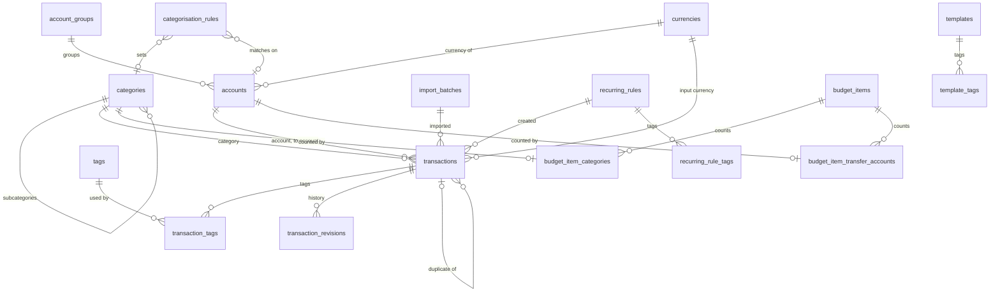

# Database design

The PostgreSQL 18 schemas for Fiscus: `core` for the platform (Phase 1) and
`fiscus` for ledger and budgets (Phase 2). The design is offline-first from the
start: every `fiscus` table the phone needs carries the sync columns of
[ADR-0002](../architecture/decisions/0002-offline-first-mobile-app.md).

| File | Holds |
| --- | --- |
| [core.dbml](core.dbml) | The `core` schema: sign-in, sessions, tokens, idempotency, audit, settings, files, backups and exports |
| [fiscus.dbml](fiscus.dbml) | The `fiscus` schema, in the table groups `ledger`, `budget`, `rules`, `imports` and `sync` |
| This README | The conventions, the money and sync rules, the SQL that DBML cannot express, the retention jobs, the decisions, and which table carries each requirement |

The DBML files are the source for the Drizzle schemas: `libs/api/src/schema.ts`
(Stage 2) and `modules/fiscus/api/src/schema/`, one file per table group (Stage 4).
`drizzle-kit` generates most of each migration. Anything marked
**Hand-copied** in the DBML is written into the migration by hand from
[Hand-written SQL](#hand-written-sql) below.

Nothing personal is stored in the repo. Income lines and budget amounts are
rows the owner enters; the seed (Stage 4) writes none of them.

## Schemas at a glance

| Schema | Owner | Tables | Syncs to the phone |
| --- | --- | --- | --- |
| `core` | `libs/api` | 17 | No. Tokens, sessions, settings and backups are online only (ADR-0002 §6) |
| `fiscus` | `modules/fiscus/api` | 24 | Yes, except `sync_tombstones`, `sync_state` and `entry_timings` |
| `pgboss` | pg-boss | Managed by pg-boss | No |

A module reads and writes only its own schema. There are no foreign keys
between schemas: `fiscus` keeps the id of a core row where it needs one, such
as the token that created a transaction, and copies what it must still show,
such as the token's name (PRD 2.2).



`budget_settings`, `income_components`, `holidays` and `pay_cycles` have no
foreign keys. A transaction's pay cycle is found by its date, not by a link
(see [Pay cycles](#pay-cycles)).

## Conventions

These hold for every schema, `core` and modules alike.

**Keys and types**

| What | Rule |
| --- | --- |
| Primary keys | `uuid` with the default `uuidv7()`, built into PostgreSQL 18. Ids are time-ordered, need no library, and on synced tables a client may supply its own UUIDv7 (EC-01, EC-02) |
| Times | `timestamptz`. Calendar dates are `date` |
| Money | `bigint` in the currency's smallest unit: whole rupiah for IDR, cents for USD (`currencies.minor_units`). Drizzle maps it with `bigint({ mode: 'number' })`; 10 miliar and a 50,000-row sum stay inside `Number.MAX_SAFE_INTEGER` (BR-18) |
| Rates | `numeric(24,12)`. Drizzle reads them as strings, and the domain converts once, rounding half up (BR-18) |
| Buffers | Integer basis points: 11500 is 1.15. BR-19 and BR-20 stay integer math in TypeScript and Dart |
| Enums | PostgreSQL enums, declared in their schema (`pgSchema('fiscus').enum(...)`). Values are only ever added, never removed, because old phone builds must keep reading the sync format (ADR-0002) |
| Names | snake_case, plural table names |
| Constraints | Named in PostgreSQL's style: `<table>_pkey`, `<table>_<column>_fkey`, `<table>_<what>_key`, `<table>_<what>_check`, `<table>_<what>_excl`, `<table>_<what>_idx` |
| Foreign keys | Every FK states its ON DELETE. RESTRICT is the default, CASCADE is for child and link rows, and SET NULL is for optional pointers |
| Extensions | None. The pay-cycle exclusion constraint is a gist index on one `daterange`, which needs no `btree_gist`. Note search uses `ILIKE`; `pg_trgm` is added only if the Stage 7 performance check measures a need |

**Row metadata**

| Kind of table | Columns |
| --- | --- |
| Editable | `created_at`, `updated_at`, `version integer` |
| Editable and synced | The above, plus `sync_txid xid8 NOT NULL DEFAULT pg_current_xact_id()` |
| Append-only | `created_at`, plus `sync_txid` if synced. `version` and `updated_at` are left out |
| Link tables | The two ids only. They travel inside their parent (see [Sync](#sync)) |

**Deleting**

- `deleted_at` is the only soft delete. A config row with it set can be restored. Its name is unique among live rows only, so a new row can reuse the name of a deleted one.
- A transaction with `deleted_at` set is **Trashed** (PRD 4.3).
- Accounts and categories are never deleted, because history keeps their names. They use `deactivated_at` instead (BR-03, FD-11), and their names are unique across all rows.
- Physical deletes happen only to transactions (the 30-day purge, BR-26), to their children through CASCADE, and to expired core rows. A purged transaction leaves a tombstone.

**Optimistic locking (EC-04)**

- `version` belongs to the touch trigger. The application never writes it.
- A service checks the version it loaded first, with `UPDATE … WHERE id = $1 AND version = $2` or `SELECT … FOR UPDATE`, and only then touches link rows. A stale version is a 409 conflict.
- The trigger bumps `version` at most once per database transaction, however many statements touch the row.

## Money and currencies

**The base currency.** The owner chooses it at setup; it is IDR for this owner
and the seed's default (A-11). Budgets, income, the afford check, stats and
reports are all in the base currency. `currencies.is_base` marks it. It can
change only while there are no transactions.

**Preferred currencies.** `fiscus.currencies` is the owner's list in Settings ›
Currencies, and the currency picker on Add transaction offers exactly these, in
`sort_order`. Each has one current rate, `base_per_unit`: how many base units
one major unit is worth, entered by hand. A rate change overwrites the column,
and the audit log keeps the old value (FR-13). There is no rate history table.

**Accounts** have one currency each. `accounts.currency_id` cannot change once
a transaction uses the account, because the composite foreign keys below
reference it.

**A transaction stores five money columns:**

| Column | Holds |
| --- | --- |
| `input_amount` | What was entered, in the input currency's smallest unit |
| `input_currency_id` | Any preferred currency. It defaults to the account's |
| `exchange_rate` | How many units of the account's currency one unit of the input currency is worth, in major units (16424 for USD to IDR). Prefilled from the two currencies' `base_per_unit` and editable to match the bank's real charge. It is 1 when the currencies are the same |
| `converted_amount` | What moved in the account, in the account's currency |
| `converted_currency_id` | Always the account's currency. `(account_id, converted_currency_id)` is a foreign key to `accounts (id, currency_id)` |

A transfer also stores the arriving side: `to_amount` and `to_currency_id` in
the To account's currency, with the same kind of composite foreign key. That
covers a top-up from an IDR account into a USD one.

For example, a USD 12.50 purchase on BCA stores an input of 1250 (cents) in
USD, a rate of 16424, and a converted 205300 (whole rupiah) in IDR. The
converted figure is what BCA charged. The domain rounds the conversion half up,
once (BR-18).

**The base value is not stored.** Budgets, stats and the afford check work it
out, in this order:

1. `input_amount` when the input currency is the base.
2. Otherwise `converted_amount` when the account's currency is the base.
3. Otherwise `converted_amount × base_per_unit` of the account's currency, rounded half up once (BR-18). In the open cycle that is the current rate; closed cycles use the rates stored in their snapshot.

Case 3 only happens on a foreign-currency account paying in a foreign currency.
Editing that currency's rate changes those rows' value in the open cycle. That
is the owner's choice (11 Oct 2026); closed cycles stay as they closed.

**BR-01** applies to both amounts and to `to_amount`: 1 to 10.000.000.000 in the
currency's smallest unit. **BR-07** compares `converted_amount`, the amount in
the account.

**Balances** are computed, never stored. Balance = `opening_balance` + incoming
`converted_amount` (income) − outgoing `converted_amount` (expenses and
transfers out) + `to_amount` (transfers in), over Confirmed and Unreviewed rows
(FD-11, FD-25, AC-09.1). At 50,000 rows the sum is a few milliseconds on
`transactions_account_idx`, and a stored balance would add write contention
and sync churn.

## Pay cycles

- `pay_cycles` holds only the cycles Fiscus runs: one Upcoming, one Open, and the Closed ones (PRD 4.3). Cycles before the first one Fiscus opened, which cover imported history, are computed by the domain from the payday rule and holidays, and have no snapshot (FD-14, FD-27).
- `nominal_payday` is the payday rule's date before any move (the 25th). It is the cycle's identity: it stays the same when a holiday moves the real payday (EC-09), so the recurring key uses it.
- `period` is `[payday, next payday)`. The exclusion constraint keeps periods from overlapping.
- **Transactions are not linked to cycles.** A transaction's cycle is the one whose `period` contains its `occurred_on` (BR-13). When a payday or holiday change moves dates, only the open and upcoming rows change; no transaction is rewritten, and nothing extra syncs (EC-09, BG-04).
- Closing a cycle stores `snapshot`, which `fiscus.guard_closed_cycle` then freezes (BR-23, FR-29). Closed cycles' figures come from it (FR-27). Edits to their transactions still change their actual spending (BR-24).

**`snapshot` fields, version 1**

| Field | Holds |
| --- | --- |
| `payday_day` | The payday rule at close |
| `income` | Each income line: name, amount |
| `items` | Each budget item: id, name, amount, projection, minimum, kind, catch-all flag, category ids, transfer account ids, order |
| `buffers` | `one_off_bp`, `monthly_bp` |
| `rates` | Each currency's `base_per_unit` at close |

A change to these fields raises `snapshot_version`. The domain reads every
version it has ever written.

## Sync

How the phone keeps a full replica (ADR-0002 §3, §4). The endpoints themselves
are specified with the API (Stage 4).

**The cursor is a transaction id.** Every synced table has
`sync_txid xid8 DEFAULT pg_current_xact_id()`, and `fiscus.touch_row()` sets it
again on every update. A pull returns rows whose `sync_txid` is at or above the
cursor and below the watermark, `pg_snapshot_xmin(pg_current_snapshot())`, so a
slow transaction cannot commit behind the cursor and be missed. Each synced
table has an index on `(sync_txid, id)` for this.

```sql
-- Once per pull, inside one REPEATABLE READ transaction
SELECT pg_snapshot_xmin(pg_current_snapshot()) AS watermark;

-- Per table, a page at a time
SELECT *
FROM fiscus.transactions
WHERE sync_txid >= $1 AND sync_txid < $2   -- cursor, watermark
  AND (sync_txid, id) > ($3, $4)           -- keyset within the page run
ORDER BY sync_txid, id
LIMIT 1000;
```

**What syncs**

| Kind | Tables |
| --- | --- |
| Synced rows | `currencies`, `account_groups`, `accounts`, `categories`, `tags`, `transactions`, `transaction_revisions`, `templates`, `budget_settings`, `income_components`, `holidays`, `budget_items`, `pay_cycles`, `categorisation_rules`, `recurring_rules`, `import_batches` |
| Travel inside their parent | `transaction_tags`, `template_tags`, `recurring_rule_tags`, `budget_item_categories`, `budget_item_transfer_accounts`. Changing a link bumps the parent through `fiscus.touch_parent()`, and the parent's record carries the ids |
| Server only | `sync_tombstones`, `sync_state`, `entry_timings` |

**Deletes.** A soft delete is an ordinary update and syncs as one. A physical
delete, which is only the transaction purge, writes `fiscus.sync_tombstones`
through `fiscus.record_tombstone()`. The phone removes a transaction's
revisions and tag links along with it. Tombstones are kept 90 days; the purge
job records the newest `sync_txid` it removed in
`sync_state.tombstones_purged_through`, and a cursor below that gets
`410 cursor_expired` and downloads everything again.

**Pushes** apply each mutation through the same service the REST endpoint
uses, with its `mutationId` as the idempotency key in
`core.idempotency_keys`. A stale `baseVersion` is a conflict, exactly as in
EC-04.

## Migrations

Each module keeps its SQL files in its own `migrations/` folder, beside its
Drizzle schema. `runMigrations` in `libs/db` applies them on deploy (FR-07):

- Core's run first, then each module's, in the order the API lists them.
  Inside a folder, files run in name order.
- Each file and its record commit in one transaction, so a failing file
  leaves neither behind.
- The record is `public.schema_migrations`: the module, the file name, a
  checksum and the time. It lives in `public` so that core's first migration
  can create the `core` schema.
- A recorded file runs once. A second run with nothing new does nothing.
- A recorded file that has changed stops the run. Fix it with a new
  migration, never by editing one that ran.
- An advisory lock makes two runners take turns.

## Hand-written SQL

DBML cannot express these, so the `core` and `fiscus` migrations (Stages 2 and 4) copy them in.
The DBML marks the same objects **Hand-copied**. Where a block repeats one
trigger over several tables, the comment names every table it applies to.

### Trigger functions

```sql
-- Bumps version once per database transaction, and moves the sync cursor.
CREATE FUNCTION fiscus.touch_row() RETURNS trigger
LANGUAGE plpgsql AS $$
BEGIN
  IF OLD.sync_txid IS DISTINCT FROM pg_current_xact_id() THEN
    NEW.version := OLD.version + 1;
  ELSE
    NEW.version := OLD.version;
  END IF;
  NEW.updated_at := now();
  NEW.sync_txid := pg_current_xact_id();
  RETURN NEW;
END;
$$;

-- On a link table: bumps the parent so its record syncs with the new links.
-- TG_ARGV[0] is the parent table, TG_ARGV[1] the link's column for it.
CREATE FUNCTION fiscus.touch_parent() RETURNS trigger
LANGUAGE plpgsql AS $$
DECLARE
  parent_id uuid;
BEGIN
  IF TG_OP = 'DELETE' THEN
    parent_id := (to_jsonb(OLD) ->> TG_ARGV[1])::uuid;
  ELSE
    parent_id := (to_jsonb(NEW) ->> TG_ARGV[1])::uuid;
  END IF;
  EXECUTE format(
    'UPDATE fiscus.%I SET sync_txid = pg_current_xact_id()
     WHERE id = $1 AND sync_txid IS DISTINCT FROM pg_current_xact_id()',
    TG_ARGV[0])
  USING parent_id;
  RETURN NULL;
END;
$$;

-- Records a physical delete for the phone.
CREATE FUNCTION fiscus.record_tombstone() RETURNS trigger
LANGUAGE plpgsql AS $$
BEGIN
  INSERT INTO fiscus.sync_tombstones (table_name, row_id)
  VALUES (TG_TABLE_NAME, OLD.id)
  ON CONFLICT (table_name, row_id)
  DO UPDATE SET sync_txid = EXCLUDED.sync_txid, deleted_at = EXCLUDED.deleted_at;
  RETURN NULL;
END;
$$;

CREATE FUNCTION fiscus.append_only() RETURNS trigger
LANGUAGE plpgsql AS $$
BEGIN
  RAISE EXCEPTION '% is append-only', TG_TABLE_NAME
    USING ERRCODE = 'restrict_violation';
END;
$$;

CREATE FUNCTION fiscus.guard_no_delete() RETURNS trigger
LANGUAGE plpgsql AS $$
BEGIN
  RAISE EXCEPTION 'rows of % are never deleted', TG_TABLE_NAME
    USING ERRCODE = 'restrict_violation';
END;
$$;

-- PRD 4.3: Closed is terminal.
CREATE FUNCTION fiscus.guard_closed_cycle() RETURNS trigger
LANGUAGE plpgsql AS $$
BEGIN
  IF OLD.status = 'closed' THEN
    RAISE EXCEPTION 'pay cycle % is closed', OLD.id
      USING ERRCODE = 'restrict_violation';
  END IF;
  IF TG_OP = 'DELETE' THEN
    RETURN OLD;
  END IF;
  RETURN NEW;
END;
$$;

-- PRD 4.3: Rolled back, Discarded and Failed are terminal, and Committed
-- can only become Rolled back.
CREATE FUNCTION fiscus.guard_import_batch() RETURNS trigger
LANGUAGE plpgsql AS $$
BEGIN
  IF OLD.status IN ('rolled_back', 'discarded', 'failed')
     OR (OLD.status = 'committed' AND NEW.status NOT IN ('committed', 'rolled_back')) THEN
    RAISE EXCEPTION 'import batch % cannot change from %', OLD.id, OLD.status
      USING ERRCODE = 'restrict_violation';
  END IF;
  RETURN NEW;
END;
$$;

-- The base currency is never removed, and changes only on an empty ledger.
CREATE FUNCTION fiscus.guard_base_currency() RETURNS trigger
LANGUAGE plpgsql AS $$
BEGIN
  IF TG_OP = 'DELETE' THEN
    IF OLD.is_base THEN
      RAISE EXCEPTION 'the base currency cannot be removed'
        USING ERRCODE = 'restrict_violation';
    END IF;
    RETURN OLD;
  END IF;
  IF OLD.is_base AND NEW.deleted_at IS NOT NULL THEN
    RAISE EXCEPTION 'the base currency cannot be removed'
      USING ERRCODE = 'restrict_violation';
  END IF;
  IF NEW.is_base IS DISTINCT FROM OLD.is_base
     AND EXISTS (SELECT 1 FROM fiscus.transactions) THEN
    RAISE EXCEPTION 'the base currency is locked once transactions exist'
      USING ERRCODE = 'restrict_violation';
  END IF;
  RETURN NEW;
END;
$$;

-- Lain-lain stays (BR-14).
CREATE FUNCTION fiscus.guard_catch_all() RETURNS trigger
LANGUAGE plpgsql AS $$
BEGIN
  IF TG_OP = 'DELETE' THEN
    IF OLD.is_catch_all THEN
      RAISE EXCEPTION 'the catch-all item cannot be deleted'
        USING ERRCODE = 'restrict_violation';
    END IF;
    RETURN OLD;
  END IF;
  IF NEW.is_catch_all IS DISTINCT FROM OLD.is_catch_all
     OR (OLD.is_catch_all AND NEW.deleted_at IS NOT NULL) THEN
    RAISE EXCEPTION 'the catch-all item cannot change or be deleted'
      USING ERRCODE = 'restrict_violation';
  END IF;
  RETURN NEW;
END;
$$;

-- Two levels, one kind per tree, and kind never changes.
CREATE FUNCTION fiscus.guard_category_tree() RETURNS trigger
LANGUAGE plpgsql AS $$
DECLARE
  parent fiscus.categories;
BEGIN
  IF TG_OP = 'UPDATE' AND NEW.kind IS DISTINCT FROM OLD.kind THEN
    RAISE EXCEPTION 'a category''s kind cannot change'
      USING ERRCODE = 'check_violation';
  END IF;
  IF NEW.parent_id IS NOT NULL THEN
    SELECT * INTO parent FROM fiscus.categories WHERE id = NEW.parent_id;
    IF parent.parent_id IS NOT NULL THEN
      RAISE EXCEPTION 'a subcategory cannot have subcategories'
        USING ERRCODE = 'check_violation';
    END IF;
    IF parent.kind IS DISTINCT FROM NEW.kind THEN
      RAISE EXCEPTION 'a subcategory has its parent''s kind'
        USING ERRCODE = 'check_violation';
    END IF;
    IF EXISTS (SELECT 1 FROM fiscus.categories WHERE parent_id = NEW.id) THEN
      RAISE EXCEPTION 'a category with subcategories cannot become one'
        USING ERRCODE = 'check_violation';
    END IF;
  END IF;
  RETURN NEW;
END;
$$;

-- core: the same touch without sync, and append-only for the audit log.
CREATE FUNCTION core.touch_row() RETURNS trigger
LANGUAGE plpgsql AS $$
BEGIN
  NEW.version := OLD.version + 1;
  NEW.updated_at := now();
  RETURN NEW;
END;
$$;

CREATE FUNCTION core.append_only() RETURNS trigger
LANGUAGE plpgsql AS $$
BEGIN
  RAISE EXCEPTION '% is append-only', TG_TABLE_NAME
    USING ERRCODE = 'restrict_violation';
END;
$$;
```

### Triggers

```sql
-- touch_row on every editable synced table
CREATE TRIGGER currencies_touch BEFORE UPDATE ON fiscus.currencies
  FOR EACH ROW EXECUTE FUNCTION fiscus.touch_row();
-- … and the same for account_groups, accounts, categories, tags,
-- transactions, templates, budget_settings, income_components, holidays,
-- budget_items, pay_cycles, categorisation_rules, recurring_rules and
-- import_batches.

-- touch_parent on every link table
CREATE TRIGGER transaction_tags_touch_parent
  AFTER INSERT OR DELETE ON fiscus.transaction_tags
  FOR EACH ROW EXECUTE FUNCTION fiscus.touch_parent('transactions', 'transaction_id');
CREATE TRIGGER template_tags_touch_parent
  AFTER INSERT OR DELETE ON fiscus.template_tags
  FOR EACH ROW EXECUTE FUNCTION fiscus.touch_parent('templates', 'template_id');
CREATE TRIGGER recurring_rule_tags_touch_parent
  AFTER INSERT OR DELETE ON fiscus.recurring_rule_tags
  FOR EACH ROW EXECUTE FUNCTION fiscus.touch_parent('recurring_rules', 'recurring_rule_id');
CREATE TRIGGER budget_item_categories_touch_parent
  AFTER INSERT OR DELETE ON fiscus.budget_item_categories
  FOR EACH ROW EXECUTE FUNCTION fiscus.touch_parent('budget_items', 'budget_item_id');
CREATE TRIGGER budget_item_transfer_accounts_touch_parent
  AFTER INSERT OR DELETE ON fiscus.budget_item_transfer_accounts
  FOR EACH ROW EXECUTE FUNCTION fiscus.touch_parent('budget_items', 'budget_item_id');

CREATE TRIGGER transactions_record_tombstone AFTER DELETE ON fiscus.transactions
  FOR EACH ROW EXECUTE FUNCTION fiscus.record_tombstone();

CREATE TRIGGER transaction_revisions_append_only BEFORE UPDATE ON fiscus.transaction_revisions
  FOR EACH ROW EXECUTE FUNCTION fiscus.append_only();

CREATE TRIGGER pay_cycles_guard BEFORE UPDATE OR DELETE ON fiscus.pay_cycles
  FOR EACH ROW EXECUTE FUNCTION fiscus.guard_closed_cycle();
CREATE TRIGGER import_batches_guard BEFORE UPDATE ON fiscus.import_batches
  FOR EACH ROW EXECUTE FUNCTION fiscus.guard_import_batch();
CREATE TRIGGER currencies_guard BEFORE UPDATE OR DELETE ON fiscus.currencies
  FOR EACH ROW EXECUTE FUNCTION fiscus.guard_base_currency();
CREATE TRIGGER budget_items_guard BEFORE UPDATE OR DELETE ON fiscus.budget_items
  FOR EACH ROW EXECUTE FUNCTION fiscus.guard_catch_all();
CREATE TRIGGER categories_guard BEFORE INSERT OR UPDATE ON fiscus.categories
  FOR EACH ROW EXECUTE FUNCTION fiscus.guard_category_tree();

-- Never deleted: batches, the singletons, accounts and categories
CREATE TRIGGER import_batches_no_delete BEFORE DELETE ON fiscus.import_batches
  FOR EACH ROW EXECUTE FUNCTION fiscus.guard_no_delete();
-- … and the same for budget_settings, sync_state, accounts and categories.

CREATE TRIGGER owner_touch BEFORE UPDATE ON core.owner
  FOR EACH ROW EXECUTE FUNCTION core.touch_row();
CREATE TRIGGER settings_touch BEFORE UPDATE ON core.settings
  FOR EACH ROW EXECUTE FUNCTION core.touch_row();
CREATE TRIGGER audit_log_append_only BEFORE UPDATE ON core.audit_log
  FOR EACH ROW EXECUTE FUNCTION core.append_only();
```

### Columns, constraints and indexes

```sql
-- BR-07 and FD-20: the note as compared. Drizzle declares this column with
-- .generatedAlwaysAs(); this is its definition.
note_key text NOT NULL
  GENERATED ALWAYS AS (lower(regexp_replace(coalesce(note, ''), '\s', '', 'g'))) STORED

-- PRD 4.3: pay cycles never overlap
ALTER TABLE fiscus.pay_cycles
  ADD CONSTRAINT pay_cycles_period_excl EXCLUDE USING gist (period WITH &&);

-- Singletons
CREATE UNIQUE INDEX owner_singleton_key ON core.owner ((true));
CREATE UNIQUE INDEX budget_settings_singleton_key ON fiscus.budget_settings ((true));
CREATE UNIQUE INDEX sync_state_singleton_key ON fiscus.sync_state ((true));

-- At most one of a kind
CREATE UNIQUE INDEX totp_factors_confirmed_key ON core.totp_factors ((true))
  WHERE confirmed_at IS NOT NULL;
CREATE UNIQUE INDEX exports_running_key ON core.exports ((true))
  WHERE status = 'running';
CREATE UNIQUE INDEX currencies_base_key ON fiscus.currencies ((true))
  WHERE is_base;
CREATE UNIQUE INDEX budget_items_catch_all_key ON fiscus.budget_items ((true))
  WHERE is_catch_all;
CREATE UNIQUE INDEX pay_cycles_open_key ON fiscus.pay_cycles ((true))
  WHERE status = 'open';
CREATE UNIQUE INDEX pay_cycles_upcoming_key ON fiscus.pay_cycles ((true))
  WHERE status = 'upcoming';

-- Names unique among live rows
CREATE UNIQUE INDEX currencies_code_key ON fiscus.currencies (code)
  WHERE deleted_at IS NULL;
CREATE UNIQUE INDEX account_groups_name_key ON fiscus.account_groups (lower(name))
  WHERE deleted_at IS NULL;
CREATE UNIQUE INDEX tags_name_key ON fiscus.tags (lower(name))
  WHERE deleted_at IS NULL;
CREATE UNIQUE INDEX templates_name_key ON fiscus.templates (lower(name))
  WHERE deleted_at IS NULL;
CREATE UNIQUE INDEX holidays_holiday_date_key ON fiscus.holidays (holiday_date)
  WHERE deleted_at IS NULL;
CREATE UNIQUE INDEX income_components_name_key ON fiscus.income_components (lower(name))
  WHERE deleted_at IS NULL;
CREATE UNIQUE INDEX budget_items_name_key ON fiscus.budget_items (lower(name))
  WHERE deleted_at IS NULL;
CREATE UNIQUE INDEX recurring_rules_name_key ON fiscus.recurring_rules (lower(name))
  WHERE deleted_at IS NULL;

-- Names unique across all rows, top-level categories included
CREATE UNIQUE INDEX categories_name_key ON fiscus.categories (kind, parent_id, lower(name))
  NULLS NOT DISTINCT;

-- Transactions: lists, filters and jobs within NFR-04 at 50,000 rows
CREATE INDEX transactions_list_idx ON fiscus.transactions
  (occurred_on DESC, occurred_at DESC, id DESC) WHERE deleted_at IS NULL;
CREATE INDEX transactions_account_idx ON fiscus.transactions
  (account_id, occurred_on) WHERE deleted_at IS NULL;
CREATE INDEX transactions_to_account_idx ON fiscus.transactions
  (to_account_id, occurred_on) WHERE to_account_id IS NOT NULL AND deleted_at IS NULL;
CREATE INDEX transactions_category_idx ON fiscus.transactions
  (category_id, occurred_on) WHERE deleted_at IS NULL;
CREATE INDEX transactions_review_idx ON fiscus.transactions
  (occurred_on, occurred_at, id) WHERE status = 'unreviewed' AND deleted_at IS NULL;
CREATE INDEX transactions_trash_idx ON fiscus.transactions
  (deleted_at) WHERE deleted_at IS NOT NULL;
CREATE INDEX transactions_source_token_idx ON fiscus.transactions
  (source_token_id, created_at) WHERE source_token_id IS NOT NULL;
CREATE INDEX transactions_import_batch_idx ON fiscus.transactions
  (import_batch_id) WHERE import_batch_id IS NOT NULL;
CREATE INDEX transactions_duplicate_idx ON fiscus.transactions
  (occurred_on, account_id, converted_amount, type) WHERE deleted_at IS NULL;
CREATE INDEX transactions_duplicate_of_idx ON fiscus.transactions
  (duplicate_of_id) WHERE duplicate_of_id IS NOT NULL;
-- BR-33: trashed rows still count, so a rerun stays a no-op (EC-19)
CREATE UNIQUE INDEX transactions_recurring_key ON fiscus.transactions
  (recurring_rule_id, recurring_payday) WHERE recurring_rule_id IS NOT NULL;

-- Other partial indexes
CREATE INDEX files_expires_at_idx ON core.files (expires_at)
  WHERE deleted_at IS NULL;
CREATE INDEX categorisation_rules_sort_order_idx ON fiscus.categorisation_rules (sort_order)
  WHERE deleted_at IS NULL AND enabled;
```

The composite foreign keys, `transactions (account_id, converted_currency_id)`
and `transactions (to_account_id, to_currency_id)` to
`accounts (id, currency_id)`, are in the DBML and need no hand-copying if
`drizzle-kit` emits them; check the generated SQL.

## Retention and scheduled clean-up

| Table | What goes | When | Job |
| --- | --- | --- | --- |
| `fiscus.transactions` | Rows 30 days in Trash, with their revisions and links. The audit log keeps id, amount and date | Daily, 03:00 | `fiscus.trash.purge` (BR-26, BG-05) |
| `fiscus.import_batches` | Uploaded and Previewed batches become Discarded, and their file is deleted | 24 hours after upload | `fiscus.imports.expire` (4.3, BG-06) |
| `fiscus.sync_tombstones` | Tombstones older than 90 days; `sync_state` records the cut | Daily | `fiscus.sync.prune` |
| `core.idempotency_keys` | Keys past `expires_at` | Hourly | Core housekeeping (BR-09) |
| `core.audit_log` | Entries older than 1 year | Daily | Core housekeeping (NFR-12) |
| `core.sessions`, `core.sign_in_links`, `core.pairing_codes` | Expired, revoked or used rows | Daily | Core housekeeping (FR-03) |
| `core.files`, `core.exports` | Files past `expires_at`; exports become Expired | Hourly | Core housekeeping (FR-12, NFR-15) |

Transactions themselves are kept indefinitely (NFR-15), and so are
`entry_timings`, accounts, categories and closed cycles.

## Design decisions

| Decision | Why |
| --- | --- |
| No `owner_id` on any table | One owner (PRD 2), and the owner lives in `core`, out of reach of a foreign key. "Who did this" is `source`, the revisions and the audit log. A second user would add it by migration (ADR-0002, "Revisit when") |
| No cycle id on transactions | The cycle follows from the date (BR-13), so a payday or holiday change rewrites no transactions (EC-09) and causes no sync churn |
| No stored balances | Summing is fast at 50,000 rows; a stored balance adds contention and sync churn |
| No per-cycle budget amounts | BR-23 applies edits from the open cycle on, and the close snapshot keeps the past |
| Possible duplicate is a column | UI-FIS-05 links to the matched transaction, which a tag cannot do. The API still shows it as the "Possible duplicate" tag (BR-07) |
| Tags are a table plus links | Renames, suggestions (UI-FIS-04) and the tag filter (FD-16). The tag ids travel inside their parent (ADR-0002) |
| Payday and buffers in `fiscus.budget_settings`, not `core.settings` | The phone works out cycles and afford checks offline (ADR-0002 §6) |
| One rate per currency, no rate history | Each transaction keeps its own rate, so past rows never depend on a later rate |
| Five money columns, base value not stored | The owner's design (11 Oct 2026). See [Money and currencies](#money-and-currencies) |
| Income is free-form lines, not fixed kinds | The owner may be salaried, run a business or do other work. Each line is a name and an amount per cycle, a negative one is a deduction, and cycle income is their sum. Working days are used only to move payday (BR-10) |
| Opening balance on accounts | Balances must match bank statements at cutover (FD-25, Stage 7) |
| Description column | Money Manager's Description field, kept apart from the 200-character note that BR-07 and FD-20 compare (FD-24) |
| No transfer fees | A fee is its own Expense; a transfer stays one record (FR-20) |
| Version bumps once per database transaction | A service may touch a row and its links in one action without tripping its own optimistic lock |

## Requirement coverage

Where each data-related requirement lives. Rules that need "now" or other rows,
such as BR-03's "active", BR-06 and BR-08's five tags, are checked by the
domain; the table names the columns they read.

| ID | Carried by |
| --- | --- |
| BR-01 | `transactions_amounts_check`, `transactions_to_amount_check`; the same range on templates and recurring rules |
| BR-02 | `transactions_transfer_check`, `transactions_category_check`, `transactions_transfer_accounts_check`; `categories.kind` |
| BR-03 | `accounts.deactivated_at`, `categories.deactivated_at` |
| BR-04, EC-07 | `occurred_on`, `occurred_at`, `utc_offset_minutes`, `transactions_occurred_on_check` |
| BR-05 | `occurred_at` and `utc_offset_minutes` NULL for imports |
| BR-07, EC-05 | `note_key`, `duplicate_of_id`, `transactions_duplicate_idx` |
| BR-08 | `note varchar(200)`, `description varchar(1000)`, `tags.name varchar(30)` |
| BR-09, EC-03, NFR-13 | `core.idempotency_keys` |
| BR-10, BR-11 | `budget_settings.payday_day`, `holidays`, `pay_cycles.period` |
| BR-12 | `income_components`: cycle income is the sum of the live lines |
| BR-13, EC-09 | `occurred_on` within `pay_cycles.period`; `nominal_payday` |
| BR-14 | `budget_item_categories`, `budget_item_transfer_accounts`, `budget_items.is_catch_all` |
| BR-15, BR-16, BR-25 | `budget_items.projection`, `minimum_amount`, `kind` and their checks |
| BR-18 | `bigint` money; one rounding in the domain |
| BR-19 to BR-22 | `budget_settings.one_off_buffer_bp`, `monthly_buffer_bp` |
| BR-23, BR-24, FR-27, FR-29 | `pay_cycles.snapshot`, `fiscus.guard_closed_cycle` |
| BR-26, AC-10.4 | `transactions.deleted_at`, the purge job, `sync_tombstones` |
| BR-27 | `import_batches_file_size_check`, `import_batches_row_count_check`, `rollback_until` |
| BR-28, FR-06 | `core.api_tokens` |
| BR-29 | `core.audit_log` (`audit_log_action_idx`) |
| BR-32, FR-31 | `categorisation_rules` |
| BR-33, EC-19 | `transactions_recurring_key` |
| BR-34 | `core.settings` (`server_timezone`) |
| FR-02, FR-04, FR-05 | `core.owner`, `passkeys`, `totp_factors`, `recovery_codes`, `sign_in_links` |
| FR-03 | `core.sessions` |
| FR-09 to FR-11 | `core.backups`, `core.alert_state`, `core.restore_tests` |
| FR-12, AC-06.2 | `core.exports`, `exports_running_key` |
| FR-13, NFR-12 | `core.audit_log` |
| FR-15, FR-16, AC-07.1 to AC-07.4 | `import_batches`, `transactions.import_batch_id` |
| FR-17 | The seed (Stage 4): currencies, account groups, accounts, categories, budget items, `budget_settings` |
| FR-19, EC-01, EC-02 | Client-supplied UUIDv7 ids and idempotency keys |
| FR-20 | One `transactions` row per transfer |
| FR-21, FR-26 | `transactions.status`, `source` and the source checks |
| FR-22, AC-10.3 | `transaction_revisions` |
| FR-23, EC-13 | `transactions_review_idx`, `transactions_source_token_idx`, `trash_reason` |
| FR-24, EC-22, NFR-04 | The `transactions` indexes |
| FR-30, A-13 | `holidays` |
| FR-32, FD-15 | `recurring_rules`, `recurring_payday` |
| FR-33, FD-20 | Snapshots and `note_key` |
| EC-04 | `version` and `fiscus.touch_row()` |
| A-11, FD-10 | `currencies`, the five money columns, the composite foreign keys |
| A-14 | `sync_txid`, `touch_row`, `touch_parent`, `sync_tombstones`, `sync_state` |
| FD-13 | `budget_item_categories_category_id_key` |
| FD-14, FD-27 | Only run cycles are stored |
| FD-24 | `transactions.description` |
| FD-25 | `accounts.opening_balance` |
| PRD 1.2 | `entry_timings` |
