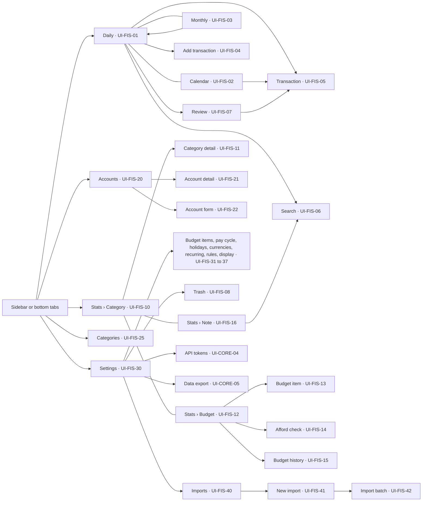
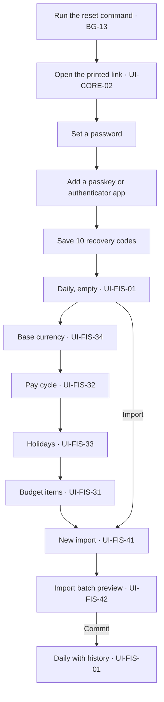
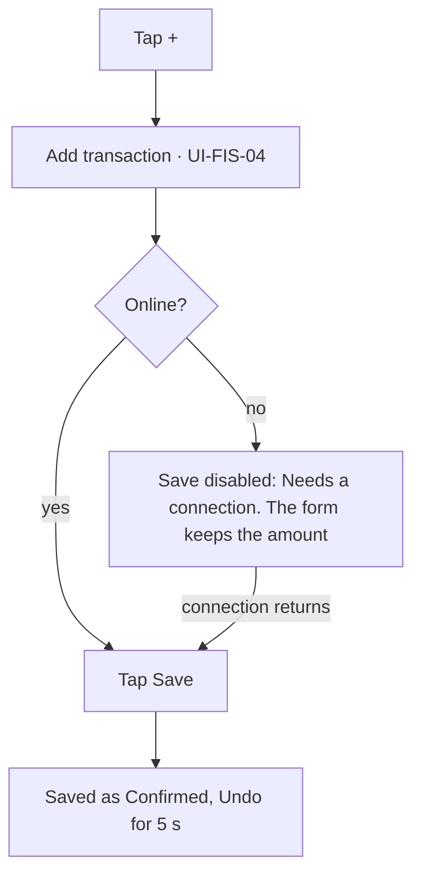
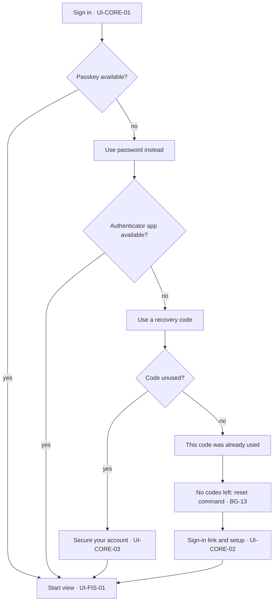

# App flow

Every screen of Fiscus, every control on it, and what happens after each action. The layout follows Realbyte's Money Manager, rebuilt for the web:

- a Daily page with fast input and the period's totals
- review views: Calendar, Monthly and Stats
- Accounts, Categories and Settings

It covers the web app on a computer and in a phone's browser. The native phone app of Phase 3 draws the same screens and adds a few of its own, listed in [phone-app.md](phone-app.md) (FD-30).

The flow comes only from the [PRD](../../prd/README.md), its [user stories](../../user-story/README.md) and the [architecture guide](../../architecture/README.md). It was written without reference to the v1 API requirements, database design or code, so it can drive the next revision of the API and data design.

| File | Screens |
| --- | --- |
| [sign-in.md](sign-in.md) | UI-CORE-01 to UI-CORE-03: sign in, setup link, recovery |
| [transactions.md](transactions.md) | UI-FIS-01 to UI-FIS-08: Daily, Calendar, Monthly, add, edit, search, review, trash |
| [stats.md](stats.md) | UI-FIS-10 to UI-FIS-16: category stats, budget, afford check, budget history, notes |
| [accounts.md](accounts.md) | UI-FIS-20 to UI-FIS-25: accounts and categories |
| [settings.md](settings.md) | UI-FIS-30 to UI-FIS-42, UI-CORE-04 and UI-CORE-05: settings, import, tokens, export |
| [background.md](background.md) | BG-01 to BG-13: jobs, API clients, the phone app's sync, and what each changes on screen |
| [phone-app.md](phone-app.md) | The phone app: how it reuses the screens above, its own screens (UI-CORE-06, UI-FIS-50 to UI-FIS-54), and J-13 to J-15 |

## Scope

The owner set this scope (FD-02): the app in full, plus the platform screens it shows.

| In this doc | Left for another doc |
| --- | --- |
| Ledger and budgets: transactions, review, trash, stats, budget, afford check, accounts, categories, settings and the Money Manager import (US-07 to US-18) | — |
| Sign-in and recovery (US-01, US-02) | The System page, backups and the audit log page (US-05, FR-09 to FR-11, FR-13) |
| API tokens with `fiscus` scopes (US-03) and the full data export (US-06) | Security settings (passkeys, TOTP, recovery codes) and the Sessions list (FR-03, FR-04) |
| The app's shell: sidebar, bottom tabs, banners and its palette (US-04, FR-08, FR-14) | The module registry (FR-07) |
| The phone app (US-19 to US-24): which screens it reuses, and its own screens by name | Its own screens in full, designed in Stage 9 of the [implementation plan](../../implementation-plan.md) |

## How to read it

| ID | Meaning |
| --- | --- |
| `UI-CORE-nn`, `UI-FIS-nn` | A screen, panel or dialog: core platform screens, then ledger and budget (`fiscus`) screens |
| `J-nn` | A journey across several screens |
| `BG-nn` | A background flow: a scheduler job, an API client or the phone app's sync |
| `FD-nn` | A flow decision: decided by the owner, proposed here, or still open |

Each screen section starts with a line giving its route, where it is reached from, how it behaves offline, and its user stories. Then come a one-line purpose, the layout, a **States** table and an **Interactions** table. The section ends with **Leads to**, the screens it exits to.

The **Source** column of every table says where a row comes from:

- A PRD ID (`US-`, `AC-`, `FR-`, `BR-`, `EC-`, `NFR-`, `A-`, or a section such as `4.3`): the PRD requires it.
- `Arch`: the [architecture guide](../../architecture/README.md) says so.
- `FD-nn`: a flow decision listed [below](#flow-decisions).
- `Proposed`: a small UI choice the PRD leaves open, such as a label, a button's place or a shortcut. Bigger proposals get an FD.

A quoted message with a PRD ID in its Source is the PRD's exact wording. Any other quoted message is a proposal.

Examples use one pay cycle. The payday rule is day 25, so the open cycle is Oct 2026, from 25 Sep to 22 Oct 2026: 25 Oct 2026 is a Sunday, which moves the next payday to Fri 23 Oct (BR-10). "Today" in examples is Thu 8 Oct 2026, day 14 of 28. Amounts are small illustrative purchases. Salary and budget amounts never appear, because nothing personal goes in the repo.

## Layout and navigation

### On a computer (1024 px and wider)

- **Sidebar:** Transactions, Stats, Accounts, Categories, Settings. Transactions carries a badge with the number of Unreviewed transactions, refreshed on each page load (5.2).
- **Top bar:** a Search button that opens UI-FIS-06, the palette button "Search Fiscus Ctrl K" (FR-08), and the user menu.
- **Panels:** Add transaction, Transaction, Budget item and Afford check open as a panel on the right, over the page. The page behind keeps its place. Each panel has its own address, so Back closes it and a link opens it directly over its home page.

### On a phone (narrower than 1024 px)

- **Bottom tabs**, as in Money Manager: Transactions (with the Review badge), Stats, Accounts, Settings. Categories is reached from Settings.
- **A round + button** floats above the tabs on Daily, Calendar and Monthly. It opens Add transaction full screen.
- **Panels open full screen**, with ← to go back.
- **In the browser, online.** There is nothing to install (Q-08). Offline, pages show what they loaded, read-only (see [Offline](#offline)). The native phone app draws the same screens and works offline ([phone-app.md](phone-app.md)).

### User menu

| # | Element | Action | What happens next | Source |
| --- | --- | --- | --- | --- |
| 1 | Theme | Choose System, Light or Dark | The theme changes at once and is remembered on this device | NFR-18, FD-22 |
| 2 | Sign out | Click | Ends this device's session and opens UI-CORE-01 | FR-03 |

### Navigation map



## Sitemap

```text
/                                       UI-FIS-01 Daily, the first page (FD-07)
├── /sign-in                            UI-CORE-01 Sign in
│   ├── /link                           UI-CORE-02 Sign-in link and setup
│   └── /secure                         UI-CORE-03 Secure your account
├── /calendar                           UI-FIS-02 Calendar
├── /monthly                            UI-FIS-03 Monthly
├── /add                                UI-FIS-04 Add transaction (panel)
├── /transactions/:id                   UI-FIS-05 Transaction (panel)
├── /search                             UI-FIS-06 Search
├── /review                             UI-FIS-07 Review
├── /trash                              UI-FIS-08 Trash
├── /stats                              UI-FIS-10 Stats › Category
│   ├── /categories/:id                 UI-FIS-11 Category detail
│   ├── /budget                         UI-FIS-12 Stats › Budget
│   │   ├── /items/:id                  UI-FIS-13 Budget item (panel)
│   │   └── /history                    UI-FIS-15 Budget history
│   └── /notes                          UI-FIS-16 Stats › Note
├── /afford                             UI-FIS-14 Afford check (panel)
├── /accounts                           UI-FIS-20 Accounts
│   ├── /:id                            UI-FIS-21 Account detail
│   └── (dialog)                        UI-FIS-22 Account form
├── /categories                         UI-FIS-25 Categories
└── /settings                           UI-FIS-30 Settings
    ├── /budget-items                   UI-FIS-31 Budget items
    ├── /pay-cycle                      UI-FIS-32 Pay cycle
    ├── /holidays                       UI-FIS-33 Holidays
    ├── /currencies                     UI-FIS-34 Currencies
    ├── /recurring                      UI-FIS-35 Recurring
    ├── /rules                          UI-FIS-36 Auto-categorise rules
    ├── /display                        UI-FIS-37 Display
    ├── /tokens                         UI-CORE-04 API tokens
    ├── /export                         UI-CORE-05 Data export
    └── /imports                        UI-FIS-40 Imports
        ├── /new                        UI-FIS-41 New import
        └── /:id                        UI-FIS-42 Import batch
```

The `UI-CORE` screens are platform screens from `libs/ui`.

The period a view shows is in its address, `?period=2026-09-25` for the cycle that starts on that day or `?month=2026-10` in calendar-month mode, so Back and shared links keep it. Search filters are in the address too (FD-16).

## Screen index

| ID | Screen | Route |
| --- | --- | --- |
| [UI-CORE-01](sign-in.md#ui-core-01-sign-in) | Sign in | `/sign-in` |
| [UI-CORE-02](sign-in.md#ui-core-02-sign-in-link-and-setup) | Sign-in link and setup | `/sign-in/link` |
| [UI-CORE-03](sign-in.md#ui-core-03-secure-your-account) | Secure your account | `/sign-in/secure` |
| [UI-FIS-01](transactions.md#ui-fis-01-daily) | Daily, the first page | `/` |
| [UI-FIS-02](transactions.md#ui-fis-02-calendar) | Calendar | `/calendar` |
| [UI-FIS-03](transactions.md#ui-fis-03-monthly) | Monthly | `/monthly` |
| [UI-FIS-04](transactions.md#ui-fis-04-add-transaction) | Add transaction | `/add` |
| [UI-FIS-05](transactions.md#ui-fis-05-transaction) | Transaction | `/transactions/:id` |
| [UI-FIS-06](transactions.md#ui-fis-06-search) | Search | `/search` |
| [UI-FIS-07](transactions.md#ui-fis-07-review) | Review | `/review` |
| [UI-FIS-08](transactions.md#ui-fis-08-trash) | Trash | `/trash` |
| [UI-FIS-10](stats.md#ui-fis-10-stats--category) | Stats › Category | `/stats` |
| [UI-FIS-11](stats.md#ui-fis-11-category-detail) | Category detail | `/stats/categories/:id` |
| [UI-FIS-12](stats.md#ui-fis-12-stats--budget) | Stats › Budget | `/stats/budget` |
| [UI-FIS-13](stats.md#ui-fis-13-budget-item) | Budget item | `/stats/budget/items/:id` |
| [UI-FIS-14](stats.md#ui-fis-14-afford-check) | Afford check | `/afford` |
| [UI-FIS-15](stats.md#ui-fis-15-budget-history) | Budget history | `/stats/budget/history` |
| [UI-FIS-16](stats.md#ui-fis-16-stats--note) | Stats › Note | `/stats/notes` |
| [UI-FIS-20](accounts.md#ui-fis-20-accounts) | Accounts | `/accounts` |
| [UI-FIS-21](accounts.md#ui-fis-21-account-detail) | Account detail | `/accounts/:id` |
| [UI-FIS-22](accounts.md#ui-fis-22-account-form) | Account form | dialog |
| [UI-FIS-25](accounts.md#ui-fis-25-categories) | Categories | `/categories` |
| [UI-FIS-30](settings.md#ui-fis-30-settings) | Settings | `/settings` |
| [UI-FIS-31](settings.md#ui-fis-31-budget-items) | Budget items | `/settings/budget-items` |
| [UI-FIS-32](settings.md#ui-fis-32-pay-cycle) | Pay cycle | `/settings/pay-cycle` |
| [UI-FIS-33](settings.md#ui-fis-33-holidays) | Holidays | `/settings/holidays` |
| [UI-FIS-34](settings.md#ui-fis-34-currencies) | Currencies | `/settings/currencies` |
| [UI-FIS-35](settings.md#ui-fis-35-recurring) | Recurring | `/settings/recurring` |
| [UI-FIS-36](settings.md#ui-fis-36-auto-categorise-rules) | Auto-categorise rules | `/settings/rules` |
| [UI-FIS-37](settings.md#ui-fis-37-display) | Display | `/settings/display` |
| [UI-FIS-40](settings.md#ui-fis-40-imports) | Imports | `/settings/imports` |
| [UI-FIS-41](settings.md#ui-fis-41-new-import) | New import | `/settings/imports/new` |
| [UI-FIS-42](settings.md#ui-fis-42-import-batch) | Import batch | `/settings/imports/:id` |
| [UI-CORE-04](settings.md#ui-core-04-api-tokens) | API tokens | `/settings/tokens` |
| [UI-CORE-05](settings.md#ui-core-05-data-export) | Data export | `/settings/export` |

## Shared patterns

### Period header

Used by Daily, Calendar, Stats › Category, Category detail, Stats › Note and Account detail. Monthly steps through years instead, and lists the year's periods. Stats › Budget and Budget history always step through pay cycles (FR-27).

It shows ‹ and › around the period label, and below it the view tabs: Daily | Calendar | Monthly on Transactions, and Category | Budget | Note on Stats. The period is a pay cycle or a calendar month, depending on the Display setting (FD-03). Either way the label is a month name, and the line under it gives the dates (FD-28):

- A pay cycle is named after the month it ends in: "Oct 2026", with "25 Sep – 22 Oct · day 14 of 28" under it.
- A calendar month reads "Oct 2026", with "1 – 31 Oct · calendar month" under it.

| # | Element | Action | What happens next | Source |
| --- | --- | --- | --- | --- |
| 1 | ‹ | Click, or ← on the keyboard | The view loads the previous period and the address updates | FD-03 |
| 2 | › | Click, or → on the keyboard | The view loads the next period. Disabled on the period that holds tomorrow, because dates can be at most 1 day ahead | BR-06, FD-03 |
| 3 | Period label | Click | A picker lists periods by year, as cycle dates or month names. Choosing one loads it | Proposed |
| 4 | Today | Click | Shown only when the view is not on the period that holds today. Goes back to it | Proposed |
| 5 | View tab | Click | Switches view and keeps the period | Proposed |

Rules behind the header:

- Cycles come from the payday rule and the holiday list for each year (BR-10, BR-11). A transaction belongs to the cycle whose dates contain its date (BR-13).
- With no payday rule set, the views use calendar months and show "Set your payday rule to see pay cycles", which links to UI-FIS-32 (FD-03).
- Cycles before the first one Fiscus opened, which covers all imported history, are computed the same way. Years with no holiday list count Monday to Friday only (BR-11, FD-14).

### Totals strip

Under the period header on Daily and Calendar, and the year header on Monthly, the strip shows **Income**, **Expense** and **Total** for the period or year, in IDR. Total = Income − Expense, with a minus sign when negative.

- It counts Confirmed and Unreviewed transactions (A-08). When any Unreviewed ones are included, a line "Includes 3 unreviewed" links to UI-FIS-07. Trashed transactions never count (AC-10.2).
- Transfers are neither income nor expense, so they are left out (FD-12). Transfers that count toward Investasi appear only in Budget (BR-14).
- An amount in another currency counts in the base currency, as FD-10 sets out.
- The strip updates right after a save, edit, trash or restore on the same screen (Proposed).

### Transaction row

Daily, the Calendar day panel, Search, Review, Trash, Account detail, Category detail and Budget item all list transactions the same way:

- **Left:** the category › subcategory for an expense or income, or "Transfer". Under it come the note and the account: "BCA", or "BCA → Wallet.ovo" for a transfer.
- **Right:** the amount (income blue, expense red, transfer grey) and the time.
- **Badges:** "Unreviewed", "Possible duplicate" (BR-07), tags (BR-08), in the phone app only "Waiting to sync" (AC-20.2), and the timezone, such as "GMT+7", when the stored offset differs from the device's current one (EC-07, BR-04).

| # | Element | Action | What happens next | Source |
| --- | --- | --- | --- | --- |
| 1 | Row | Click, or Enter when focused | Opens UI-FIS-05 as a panel | Proposed |
| 2 | Confirm (on hover, Unreviewed only) | Click | Unreviewed → Confirmed. The badge goes, a history entry is added, and the Review count drops by one | FR-23, 4.3 |
| 3 | Trash (on hover) | Click | → Trashed. The row leaves the list and the totals at once. Toast "Moved to Trash" with Undo for 5 s; Undo restores it to its previous state | AC-10.2, 4.3, Proposed |
| 4 | "Possible duplicate" badge | Click | Opens UI-FIS-05 at its duplicate section | BR-07, Proposed |
| 5 | "Waiting to sync" badge (phone app) | Tap | Opens the sync status, UI-FIS-51 | AC-20.2, Proposed |

On a phone, swiping a row left shows Trash, and Confirm for Unreviewed rows. Both buttons are also inside UI-FIS-05 (Proposed).

### Amounts, dates and colours

- Amounts read "Rp 25.000": whole rupiah, no decimals (NFR-19, BR-01). A negative total reads "−Rp 50.000". Another currency uses its own code and decimals, such as "USD 12.50", with "≈ Rp …" beside it (FD-10).
- Dates read "29 Sep 2026" in the device's timezone (NFR-19). Day headers read "Thu 8 Oct", and times "08:10" on a 24-hour clock.
- Colours follow Money Manager: income blue, expense red, transfer grey. AMAN is green, KETAT amber and BELUM red. Colour is never the only signal: every amount also has its type icon, and every status its word (NFR-18).
- The UI is in English (NFR-19). Budget and category names are the owner's own, often Indonesian, and AMAN, KETAT and BELUM keep the PRD's words.

### Panels, dialogs and toasts

- **Panels:** Esc or × closes one. If it has unsaved changes, a dialog asks "Discard changes?" with Discard and Keep editing (Proposed).
- **Confirm dialogs** appear only for actions that affect many records or that Undo can't reverse: Empty trash, Commit, Discard or Roll back an import, Confirm all, Trash all from this token, Revoke a token, Delete a budget item or rule, Deactivate an account or category, and saving a change that moves cycle dates. Trashing one transaction never asks, because it offers Undo (Proposed).
- **Toasts** appear at the bottom of the screen, above the tabs on a phone. Undo toasts last 5 seconds (FR-18), others 3 seconds. A new toast replaces the old one (Proposed).

### Banners

Banners stack at the top of the content area in this order:

| Banner | When | Text | Actions | Source |
| --- | --- | --- | --- | --- |
| Database down | The API answers 503 | "Fiscus can't reach its database. Retrying." | None; the app retries after the Retry-After delay of 30 s | EC-16, BG-10 |
| Offline | The browser loses its connection | "You're offline. Changes need a connection." | None | NFR-16, Q-08, Proposed |
| Cycle opened | The first visit after payday | "New pay cycle: 23 Oct – 24 Nov 2026. 2 recurring transactions to review." | Review → UI-FIS-07; Dismiss | 5.2, BG-03 |
| To review (Daily only) | Unreviewed transactions exist | "3 transactions to review" | Review → UI-FIS-07 | 5.2, FR-23 |
| New second factor | After "Later" on UI-CORE-03 | "You signed in with a recovery code. Register a new passkey or authenticator app." | Set up → UI-CORE-03 | AC-02.1, Proposed |
| Update ready | A new version was deployed | "A new version of Fiscus is ready." | Reload | NFR-06, Proposed |

### Empty and first-run states

Every page with nothing to show gives one line of guidance and its main action (EC-21). On a fresh install, Daily shows "Import from Money Manager to get started" with an Import button. Each screen's States table gives its own line.

### Errors and validation

- Field rules are checked as you type where the browser can (BR-01, BR-08), and always again by the server on save. `fiscus/web` may import the domain for these instant checks (Arch).
- A field error appears under its field and names it (BR-02, BR-08, BR-25, BR-28).
- The PRD's own messages appear word for word, for example "Amount must be a whole rupiah value from 1 to 10 miliar" (BR-01), "Date is in the future" (BR-06) and "Choose two different accounts" (AC-09.3).
- Failed requests:
  - 401 opens sign-in (see [Session expiry](#session-expiry)).
  - 409 opens the edit conflict view (EC-04).
  - 422 shows field errors.
  - 503 shows the database banner.
  - A network error shows the toast "Couldn't reach Fiscus. Try again." with Retry (Proposed).

### Offline

- The web app is online only, on a computer and on a phone (Q-08, NFR-16). It keeps no queue and installs nothing.
- Offline, every page shows the Offline banner. Whatever was already loaded stays visible, read-only, and actions that need the server are disabled with the tooltip "Needs a connection" (Proposed).
- That includes Save on Add transaction and the quick-add bar. The form keeps what was typed, so it can be saved once the connection is back (AC-08.3).
- Reading and writing offline is the phone app's, which keeps its own copy of the data and syncs (US-20, BG-07, [phone-app.md](phone-app.md)).

### Session expiry

A session lasts 30 days (FR-03). When a request returns 401, the app opens UI-CORE-01 and keeps the current address. After sign-in it returns there. Unsaved form values are lost (Proposed).

### Edit conflicts

Each save carries the version it loaded. A stale save is refused with "Changed elsewhere. Review both versions." and both versions appear side by side (EC-04), with Keep mine and Use theirs (FD-17). Details are in UI-FIS-05.

### Loading

The first time Fiscus opens, its code loads on demand (NFR-22) behind a skeleton of the page. Lists show skeleton rows. A Save button shows a spinner and stays disabled while its request runs. That, together with the client id, keeps a double click from saving twice (EC-01).

### Keyboard and accessibility

- Every action is reachable by keyboard, and both themes meet WCAG 2.2 AA (NFR-18).
- Shortcuts (Proposed):
  - Ctrl/Cmd + K opens the palette (FR-08).
  - / opens Search.
  - N opens Add transaction.
  - ← and → step the period.
  - Arrow keys move around the Calendar grid.
  - Esc closes a panel or dialog.
- Every drag-to-reorder list also has Move up and Move down buttons.
- Every chart has a list or table next to it with the same numbers.

### Palette entries

The palette (FR-08, US-04) gets these entries from the `fiscus` manifest (FR-07). Enter opens the result, and an empty query lists recent items.

| Entry | Opens | Keywords |
| --- | --- | --- |
| Add transaction | UI-FIS-04 | expense, income, spend, new |
| Add transfer | UI-FIS-04 on the Transfer tab | transfer, top up, move money |
| Daily, Calendar, Monthly | UI-FIS-01, 02, 03 | transactions, ledger |
| Search transactions | UI-FIS-06 | find, filter |
| Review | UI-FIS-07 | unreviewed, inbox, confirm |
| Trash | UI-FIS-08 | deleted, restore |
| Stats, Budget, Notes, Budget history | UI-FIS-10, 12, 16, 15 | report, chart, pie, trend |
| Check affordability | UI-FIS-14 | afford, aman, ketat, belum, can I buy |
| Accounts, Categories | UI-FIS-20, 25 | balance, wallet, bank |
| Import from Money Manager | UI-FIS-41 | tsv, money manager, migrate |
| Settings pages | UI-FIS-31 to UI-FIS-37 | budget, payday, holiday, currency, recurring, rule, display |
| New API token | UI-CORE-04, create dialog open | token, api, ingest |
| Export all data | UI-CORE-05 | export, zip, backup |

### Privacy

- Notes, amounts and file names never go into application logs (NFR-11). Search terms sit in the page address, so the server redacts query strings from its logs (Arch).
- The only uploaded file is the Money Manager import. It is deleted when its preview ends, and at the latest 24 hours after upload (4.3).

## Journeys

### J-01 First run

1. On the server, run the reset command. On an empty install it creates the owner and prints a sign-in link (BG-13, FD-05).
2. Open the link: UI-CORE-02. Set a password, add a passkey or an authenticator app, and save the 10 recovery codes.
3. Fiscus opens on Daily (UI-FIS-01), empty: "Import from Money Manager to get started".
4. Settings › Currencies (UI-FIS-34): confirm the base currency, IDR by default, and add any other currencies you use. The base locks once the first transaction is saved (FD-10).
5. Settings › Pay cycle (UI-FIS-32): save the payday rule and your income lines. The period header switches from months to pay cycles.
6. Settings › Holidays (UI-FIS-33): check this year's and next year's lists, seeded from the budgeting skill (A-13).
7. Settings › Budget items (UI-FIS-31): enter an amount for each seeded item (FR-17), and choose the categories each one counts. Only Investasi comes with a rule, transfers to Stockbit or Pluang (BR-14).
8. Settings › Imports › New import (UI-FIS-41, then UI-FIS-42): upload the TSV, check the first 10 dates, map unknown accounts and categories, review the duplicates, and Commit.
9. Daily shows the history, and Stats › Budget shows the open cycle.



### J-02 Quick add on a laptop

1. Daily opens with the cursor in the quick-add bar's amount field. Category and account show the last ones used.
2. Type `25000`, press Tab past the prefilled category and account, type the note "warung", and press Enter.
3. The row appears under today, the totals update, and the toast "Saved" offers Undo for 5 s (FR-18, AC-08.2). The amount and note clear and the cursor returns to the amount, ready for the next one.

### J-03 Add on a phone, in the browser

1. Tap + on Daily. UI-FIS-04 opens full screen with the amount focused and a numeric keypad (AC-08.1).
2. Type the amount and tap Save. It is saved as Confirmed with the current date and time in the phone's timezone, and Undo shows for 5 seconds (AC-08.2).
3. With no connection, Save is disabled and the form keeps the amount, under the Offline banner (AC-08.3). Logging with no connection is the phone app's ([J-14](phone-app.md#j-14-log-offline-then-sync)).



### J-04 A top-up as a transfer

1. Tap +, choose the Transfer tab, and enter Rp 100.000 from BCA to Wallet.ovo. Save.
2. On Accounts (UI-FIS-20), BCA falls and Wallet.ovo rises by Rp 100.000, and no budget item changes (AC-09.1).
3. A transfer to Stockbit or Pluang counts toward Investasi on Stats › Budget (AC-09.2).
4. Choosing the same account on both sides is refused with "Choose two different accounts" (AC-09.3).

### J-05 Weekly review

1. Daily shows "5 transactions to review", and the Transactions tab has a badge.
2. Review (UI-FIS-07) lists them oldest first, each with its source: a token name or a recurring rule.
3. For each one, Confirm it, open it to edit and press Save and confirm, or Trash it.
4. Confirm all handles the rest. The list ends with "Nothing to review" and the badge clears.

### J-06 Looking back over the cycle

1. On Calendar (UI-FIS-02), click a day with a high expense. The day panel lists its transactions; open one to fix its category.
2. On Monthly (UI-FIS-03), expand the cycle to see its weeks, then click a week to see it on Daily.
3. On Stats › Category (UI-FIS-10), click the largest slice to open Category detail (UI-FIS-11) with its subcategories, its 6-period trend and its transactions.

### J-07 Payday

1. At 00:00 server time on payday, the open cycle closes with its configuration snapshot, the next one opens, and each recurring rule creates one Unreviewed transaction (BG-03).
2. The next visit shows the banner "New pay cycle: 23 Oct – 24 Nov 2026. 2 recurring transactions to review."
3. Review confirms the kost rent. Stats › Budget shows day 1 of the new cycle with "Projections settle after day 7".

### J-08 Can I afford it?

1. On Stats › Budget, click "Can I afford…?" to open UI-FIS-14.
2. Enter Rp 1.000.000, choose One-off, and click Check. The result is AMAN, KETAT or BELUM with the numbers behind it (AC-14.1, AC-14.2).
3. KETAT lists the 3 flexible items with the most budget left. Clicking one opens its Budget item panel.
4. Monthly is judged against the lowest capacity of the open cycle and up to 3 closed cycles (AC-14.3). With no closed cycle yet, the result says "Low confidence: less than one full cycle of data" (AC-14.4).

### J-09 A token leaks

1. Settings › API tokens (UI-CORE-04): Revoke the leaked token. Calls with it fail with 401 from now on (2.2).
2. The revoke dialog's "Review what it created" opens Review with that token chosen in "Trash all from this token since a date" (EC-13).
3. Pick the date and confirm. Its transactions move to Trash, where any can be restored for 30 days.

### J-10 Roll back an import

1. Settings › Imports (UI-FIS-40): open the batch, which shows "Committed · roll back until 16 Oct 2026".
2. Roll back, then confirm. The batch's transactions move to Trash and the batch is Rolled back (FR-16).
3. After 7 days the button is replaced by "Rollback window closed" (BR-27).

### J-11 A new holiday moves payday

1. Settings › Holidays (UI-FIS-33): add a holiday on an upcoming payday, for example 25 Nov 2026.
2. A dialog shows the date changes: payday moves to Tue 24 Nov, so the cycle that opens on 23 Oct now ends on 23 Nov. Save.
3. The toast "Pay cycle dates changed" appears, transactions move to the cycle their dates now fall in, and the period header shows the new dates (EC-09, BG-04).

### J-12 Locked out, then a recovery code

1. The phone with the passkey and authenticator app is lost. On Sign in, choose "Use password instead", then "Use a recovery code".
2. Password and an unused code sign you in and burn the code. UI-CORE-03 then asks for a new passkey or authenticator app (AC-02.1).
3. A code used before is refused with "This code was already used" (AC-02.2).
4. With no codes left, the reset command over SSH prints a new sign-in link (BG-13, EC-20).



## Flow decisions

Status is **Decided** (the owner chose it, 8 Oct 2026), **Proposed** (this flow's choice, to confirm), or **Open** (needs the owner's answer before building).

| ID | Decision | Why it is needed | Screens | Status |
| --- | --- | --- | --- | --- |
| FD-01 | The UI, the routes and the code all say Fiscus. The app is served at `/`, code ids are `fiscus`, and the token form shows scopes as "Read (`fiscus:read`)" | One name for the app, the project and the code | All | Decided |
| FD-02 | This doc covers the app plus the platform screens it shows. System, Security and Sessions get their own flow later | Focus on the app used every day | All | Decided |
| FD-03 | Views step through pay cycles by default, and a Display setting switches them to calendar months, like Money Manager's month start date. Budget always uses cycles. With no payday rule, views fall back to months with a prompt. › stops at the period that holds tomorrow. Calendar weeks start on Monday, and days outside the cycle are dimmed and cannot be clicked | Money Manager periods versus PRD pay cycles (BR-10, FR-27) | UI-FIS-01, 02, 03, 10, 11, 16, 21, 37 | Decided (mode); Proposed (details) |
| FD-04 | On a computer, a quick-add bar on Daily saves an expense or income dated now. Another date, tags and transfers go through the full form. The full form has Save and Continue (save and add another), and a transaction has Copy (prefill a new one), as in Money Manager | Fast input on the first page (FR-18) | UI-FIS-01, 04, 05 | Decided (bar and form); Proposed (details) |
| FD-05 | On an empty install, the server reset command (FR-05) creates the owner, and its one-time link opens the setup wizard at `/sign-in/link`: password, then a passkey and/or authenticator app, then recovery codes. After a reset, the password step offers "Keep my current password" | The PRD never says how the owner account is first created | UI-CORE-02, BG-13 | Proposed |
| FD-06 | Password and code go on one form with one generic error, "Password or code is wrong". A cancelled passkey prompt does not count toward BR-29, but a failed passkey check does. Setup needs at least one second factor | Sign-in details the PRD leaves open | UI-CORE-01, 02, 03 | Proposed |
| FD-07 | `/` opens the start view (FR-14), and so do sign-in and opening the phone app: Daily by default. Display can pick Calendar or Monthly instead, like Money Manager's start screen | The first page is Daily | UI-FIS-01, 37 | Decided (Daily); Proposed (start view) |
| FD-08 | Undo after a save moves the new transaction to Trash, because PRD 4.3 has no hard delete. In the phone app, Undo on a change still waiting to sync removes it from the queue, so it never reaches Fiscus | FR-18 asks for Undo without saying what it does | UI-FIS-01, 04 | Proposed |
| FD-09 | Categorisation rules run on every create, quick add included, since BR-32 makes no exception. When a rule changes a value, the toast names it: "Category set by rule 'warung'" | Whether rules may override what the owner picked | UI-FIS-01, 04, 36 | Proposed |
| FD-10 | Each account has one currency. Settings › Currencies is the list of preferred currencies, each with one rate to the base currency, entered by hand. The base is chosen at setup, IDR by default, and locks once a transaction exists. A transaction may be in any preferred currency: it stores the amount entered and its currency, the exchange rate, and the amount in the account's currency, prefilled from the rates and editable to match the bank's charge. A transfer also stores the amount received in the destination's currency. Budgets and stats count the amount entered when it is in the base, else the account's amount when the account is in the base, else the account's amount at the current rate. Balances show the account's currency, with the base value at the current rate | A-11 allows other currencies but the PRD has no UI for them | UI-FIS-04, 20, 21, 22, 34 | Decided (11 Oct 2026) |
| FD-11 | Accounts are grouped (Cash, Bank, E-wallet, Investment, Other) as in Money Manager. They are deactivated, never deleted. Balances start from the account's opening balance (FD-25) and count Confirmed and Unreviewed transactions, as budgets do. Assets are positive balances, Liabilities negative ones | AC-09.1 implies balances, but the PRD has no accounts screen | UI-FIS-20, 21, 22 | Proposed |
| FD-12 | The totals strip and Category stats leave transfers out and include Unreviewed transactions (A-08) | Transfers are neither income nor expense (BR-02) | UI-FIS-01, 02, 03, 10, 11, 16 | Proposed |
| FD-13 | Remaining = budget − spent. A category counts toward at most one budget item. Lain-lain stays at budget Rp 0 and flexible (BR-14), even though FR-17 says the owner enters all amounts | "Remaining" has no formula, and an expense matching two items would count twice | UI-FIS-12, 13, 31 | Proposed |
| FD-14 | Cycles from before Fiscus's first open cycle, which covers all imported history, have no configuration snapshot. Budget shows only their spending per current item, labelled "Imported history". Budget history includes them; the afford check ignores them | FR-27 and BR-20 assume snapshots, which imported cycles lack | UI-FIS-12, 14, 15 | Proposed |
| FD-15 | A recurring rule creates its transaction dated the cycle's first day, because BR-06 forbids dates more than 1 day ahead. A new rule first runs at the next payday | FR-32 runs rules when a cycle opens | UI-FIS-35, BG-03 | Proposed |
| FD-16 | Search adds filters beyond FR-24 (type, tag, source, budget item), and every filter is kept in the page address | Budget items and token leaks need them (BR-14, EC-13) | UI-FIS-06, 13, 15 | Proposed |
| FD-17 | An edit conflict offers Keep mine (saves your values over the newer version) or Use theirs (discards yours) | EC-04 shows both versions but no way forward | UI-FIS-05 | Proposed |
| FD-18 | "Trash all from this token since a date" trashes only Unreviewed transactions unless "Also trash confirmed ones" is ticked. Confirm all skips any transaction changed since the list loaded and says how many it skipped | FR-23 names the actions only | UI-FIS-07 | Proposed |
| FD-19 | In an import preview, changing the date format re-parses the stored file, and an unknown account or category can be mapped to a new one created on the spot | AC-07.4 says "map or skip" | UI-FIS-42 | Proposed |
| FD-20 | Stats › Note groups notes that are equal after ignoring case and spaces, the comparison BR-07 uses | FR-33 ranks notes without saying how to group them | UI-FIS-15, 16 | Proposed |
| FD-21 | A token with the `fiscus:ingest` scope cannot have `fiscus:read`, `fiscus:write` or `fiscus:settings` too | Keeps public tokens write-only (2.2) | UI-CORE-04 | Proposed |
| FD-22 | Display settings (period mode, start view, theme) are kept per device, not per account | Like Money Manager, and needs no server setting | UI-FIS-37 | Proposed |
| FD-23 | Does the Money Manager export hold a `Transfer-In` row for each `Transfer-Out`? If yes, the preview should skip them so a transfer is not imported twice | AC-07.3 mentions only `Transfer-Out` | UI-FIS-42 | Open |
| FD-24 | The export's Description column goes to its own field, Description, up to 1,000 characters (BR-08). It sits under Note on UI-FIS-04 and UI-FIS-05. The 200-character note stays the one BR-07 and FD-20 compare | FR-15 parses 8 columns | UI-FIS-42, 04 | Decided (11 Oct 2026) |
| FD-25 | Each account has an opening balance in its own currency, set on UI-FIS-22. It may be negative for a liability. Balances start from it; budgets and stats ignore it | AC-09.1 balances; the TSV has no Money Manager initial balances | UI-FIS-20, 22 | Decided (11 Oct 2026) |
| FD-26 | In a categorisation rule's note template, such as "breakfast: …", what does "…" stand for: the original note, or nothing? | AC-16.1 example | UI-FIS-36 | Open |
| FD-27 | Saving the first payday rule opens the cycle that holds today at once, without waiting for the next payday. Earlier cycles become imported history (FD-14) | PRD 4.3 opens cycles only at payday, which would leave a new install with no open cycle for weeks | UI-FIS-32, UI-FIS-12 | Proposed |
| FD-28 | A pay cycle is named after the month it ends in: 25 Sep – 22 Oct 2026 is "Oct 2026". Period headers, Monthly rows and cycle references show the name first and the dates after it, "Oct 2026 · 25 Sep – 22 Oct". Monthly lists the cycles named in its year | "25 Sep – 22 Oct 2026" is long and hard to scan, especially on a phone, and Money Manager also names periods by month | UI-FIS-01, 02, 03, 05, 10, 12 to 16, 21, 32, 35 | Decided |
| FD-29 | Review works like reviewing a Money Manager import. Fix a transaction on UI-FIS-05, where Save and confirm returns to Review. Confirm or Trash one. Select some, then Confirm N or Trash N. Or Confirm all and Trash all, which act on what the filter shows and ask once. Trash keeps PRD 4.3: restorable for 30 days, with Undo. Review also has a permanent row at the top of Settings. The token tool (EC-13) stays in ⋯. Money Manager imports keep their own preview, UI-FIS-42 | Correcting and clearing many automatic transactions should be as fast as Money Manager's import review | UI-FIS-05, UI-FIS-07, UI-FIS-30 | Decided |
| FD-30 | The phone app draws the web app's phone frames with the same tokens, on Android first and iOS later. Only its own screens are new: UI-CORE-06 and UI-FIS-50 to UI-FIS-54. Screens that need a signed-in session (imports, tokens, the export, Empty trash) open in the web app in the browser | ADR-0002 leaves the phone app's look to the redesign | All phone frames, [phone-app.md](phone-app.md) | Decided (12 Oct 2026) |
| FD-31 | What does the phone app offer in place of Sign out: Unpair (revoke its own token and erase its copy), or nothing, leaving revocation to Settings › API tokens on the web? | The phone app has no session to end (US-19) | UI-FIS-30, UI-FIS-50 | Open |

## Coverage

| Story | Screens and flows |
| --- | --- |
| US-01 Sign in | UI-CORE-01, BG-11 |
| US-02 Recover access | UI-CORE-01, UI-CORE-02, UI-CORE-03, BG-13, J-12 |
| US-03 Manage API tokens | UI-CORE-04, BG-09, J-09 |
| US-04 Find and open pages | Palette entries |
| US-06 Export my data | UI-CORE-05, BG-12 |
| US-07 Migrate from Money Manager | UI-FIS-40, UI-FIS-41, UI-FIS-42, BG-06, J-01, J-10 |
| US-08 Log an expense in seconds | UI-FIS-01, UI-FIS-04, J-02, J-03 |
| US-09 Record transfers | UI-FIS-04, UI-FIS-20, J-04 |
| US-10 Review, correct and trash | UI-FIS-05, UI-FIS-07, UI-FIS-08, BG-05, J-05 |
| US-11 Private API for my scripts | BG-02 |
| US-12 Public ingest endpoint | BG-01 |
| US-13 See this cycle's budget | UI-FIS-12, UI-FIS-13 |
| US-14 Check if I can afford something | UI-FIS-14, J-08 |
| US-15 Configure my budget | UI-FIS-31, UI-FIS-32, UI-FIS-33, BG-04, J-11 |
| US-16 Auto-categorise | UI-FIS-36, BG-01, BG-02 |
| US-17 Recurring transactions | UI-FIS-35, BG-03, J-07 |
| US-18 Reports | UI-FIS-15, UI-FIS-16 |
| US-19 Pair my phone | UI-CORE-06, UI-FIS-50, J-13 |
| US-20 Use the ledger offline | The reused screens in [phone-app.md](phone-app.md), UI-FIS-51, J-14 |
| US-21 Sync without losing or doubling anything | BG-07, UI-FIS-51, UI-FIS-52, J-14 |
| US-22 Resolve a conflict | UI-FIS-53, J-15 |
| US-23 See my budget offline | UI-FIS-12 to UI-FIS-14 in the phone app |
| US-24 Lock the app | UI-FIS-54 |

These PRD items are covered elsewhere and not here:

| Items | Why not here |
| --- | --- |
| FR-07 | The module registry |
| US-05, FR-09, FR-10, FR-11, EC-18 | Backups and the System page |
| FR-13, NFR-12 | The audit log page. Each action here notes when it writes an audit entry |
| FR-03 (sessions list), FR-04 (regenerating codes) | Security and Sessions settings |
| FR-01, NFR-08 | Network reach. BG-01 notes the one public path |
| NFR-01 to NFR-03, NFR-04, NFR-05, NFR-07, NFR-09, NFR-10, NFR-13 to NFR-15, NFR-20 to NFR-25 | Limits, performance, security and build rules with no screen of their own. Where they shape a flow, the row cites them |
