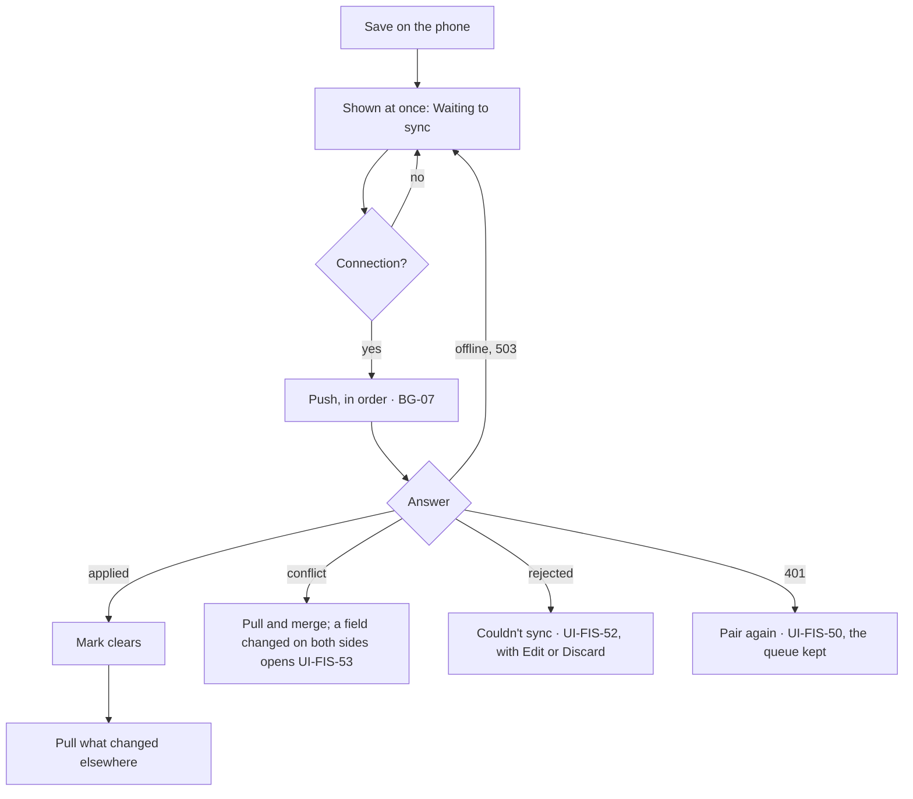

# Phone app

The native Flutter app of Phase 3 (US-19 to US-24, [ADR-0002](../../architecture/decisions/0002-offline-first-mobile-app.md)). Android comes first, and iOS waits for Q-06. The app draws the web app's phone frames with the same tokens (FD-30). It reads and writes its own copy of the data and syncs over the tailnet (BG-07). This page says how it reuses the screens in this flow, and names the screens it adds.

The added screens are designed in Stage 9 of the [implementation plan](../../implementation-plan.md). UI-CORE-06 is a web screen, so it is designed before Stage 8 builds pairing. Shared parts (the period header, totals strip, transaction row, toasts) work as the [README](README.md#shared-patterns) describes.

## How it differs from the web app on a phone

| | Web app, in the phone's browser | Phone app | Source |
| --- | --- | --- | --- |
| Getting it | Nothing to install | A signed APK from CI, installed by hand | Q-08, Arch |
| Getting in | A 30-day session, from UI-CORE-01 | Pairing, once (UI-FIS-50). After that it opens on the start view, behind the lock if it is on | FR-03, FR-34, FR-44 |
| Data | Loaded from the server for each page | Its own encrypted copy, kept up to date by sync | FR-35, NFR-23 |
| Offline | Read-only, as loaded | Reads, and the changes in US-20, which wait to sync | NFR-16, FR-36 |
| Budget and afford check | From the server | From the server, so online only, until US-23 ships | FR-43 |
| Screens that need a signed-in session | In place | Open in the web app in the phone's browser | AC-20.6, 2.2 |
| Edit conflicts | Keep mine or Use theirs on UI-FIS-05 | Merged field by field. Only a field both sides changed is asked about, on UI-FIS-53 | FD-17, FR-42 |
| Palette | None on a phone | None | Phone design |

## Screens it reuses

Each screen works as its section in this flow describes, drawn from its phone frame, except as noted.

| Screen | In the phone app | Offline | Source |
| --- | --- | --- | --- |
| UI-CORE-01 to UI-CORE-03, sign-in and recovery | Not in the app. Pairing replaces sign-in, and recovery stays in the web app | — | FR-34 |
| UI-FIS-01 Daily | As in this flow. Pull to refresh starts a sync. Changes not yet synced show "Waiting to sync" | Works | AC-20.1, AC-20.2, BG-07 |
| UI-FIS-02 Calendar, UI-FIS-03 Monthly | As in this flow | Works | AC-20.1 |
| UI-FIS-04 Add transaction | As in this flow, with the keypad, Save and Continue, and the timer | Works. A save shows at once, marked "Waiting to sync" | AC-20.3, FR-38 |
| UI-FIS-05 Transaction | Edit, confirm, trash, restore, Copy and history | Works | AC-20.1, AC-20.2 |
| UI-FIS-06 Search | Searches the phone's copy | Works | FR-35 |
| UI-FIS-07 Review | Confirm, Trash, Confirm all and Trash all | Works, except "Trash all from this token since a date" | FR-36, AC-20.5 |
| UI-FIS-08 Trash | Restore | Restore works. Empty trash opens the web app | 2.2, AC-20.6 |
| UI-FIS-10, 11 and 16, Stats › Category, Category detail and Note | Computed from the phone's copy | Works | AC-20.1 |
| UI-FIS-12 to UI-FIS-15, Budget, Budget item, Afford check and Budget history | Figures from the server | "Needs a connection", until US-23 ships | FR-43, AC-20.5 |
| UI-FIS-20 to UI-FIS-22 Accounts, UI-FIS-25 Categories | As in this flow | Works | AC-20.1, AC-20.2 |
| UI-FIS-30 Settings | The same rows. Imports, API tokens, Export and Security open the web app. A Sync row opens UI-FIS-51, and a Lock switch turns UI-FIS-54 on. What replaces Sign out is FD-31 | The list works | AC-20.6, FD-31 |
| UI-FIS-31 Budget items | Items and their links | Items work. The afford buffers need a connection | FR-36 |
| UI-FIS-32 Pay cycle, UI-FIS-33 Holidays, UI-FIS-34 Currencies | As in this flow | "Needs a connection" | FR-36, AC-20.5 |
| UI-FIS-35 Recurring, UI-FIS-36 Auto-categorise rules | As in this flow | Works | FR-36 |
| UI-FIS-37 Display | Kept on the phone | Works | FD-22 |
| UI-FIS-40 to UI-FIS-42 Imports, UI-CORE-04 API tokens, UI-CORE-05 Data export | Open in the web app | — | AC-20.6, 2.2 |

## Its own screens

| ID | Screen | Where | Purpose | Source |
| --- | --- | --- | --- | --- |
| UI-CORE-06 | Pair a phone | Web, from UI-CORE-04 | Shows a one-time code as a QR code, valid for 10 minutes. Once the phone has paired, it shows the phone's name and closes. A used or expired code is refused | US-19, FR-34, BR-37 |
| UI-FIS-50 | Pair this phone | Phone, the first screen | Scans the code and downloads everything, with progress. After a 401 it opens again to pair anew, keeping the queue | US-19, FR-34, FR-35, AC-19.3 |
| UI-FIS-51 | Sync status | Phone: a status line on Daily, the "Waiting to sync" badge, and Settings › Sync | When the app last synced, how many changes are waiting, and Sync now. Links to UI-FIS-52 when any change was refused | US-21, BG-07, 5.2 |
| UI-FIS-52 | Couldn't sync | Phone, from UI-FIS-51 | Each refused change with the server's reason, and the changes waiting behind it. Edit sends it again as a new mutation; Discard puts the row back as the server has it | US-21, FR-41, EC-25, 4.3 |
| UI-FIS-53 | Changed elsewhere | Phone, opened by a sync | For each field both sides changed, both values and a choice. For a transaction trashed elsewhere, Restore and apply, or Discard | US-22, FR-42, EC-04, EC-24 |
| UI-FIS-54 | Lock | Phone, on open and on return | Asks for the fingerprint, face or phone PIN before any data shows | US-24, FR-44 |

The web app's old sync queue sheet carries into UI-FIS-51 and UI-FIS-52: its waiting list, Retry now (now Sync now), Edit and Discard.

## Journeys

### J-13 Pair the phone

1. On the web: Settings › API tokens › Pair a phone (UI-CORE-06). A QR code shows, valid for 10 minutes.
2. On the phone: install the APK and open it. UI-FIS-50 asks to scan the code.
3. The phone gets its token, named after it, and downloads everything (FR-34, FR-35). Daily opens.
4. On the web, the token list now shows the phone's token. Revoking it there stops the phone's sync, and the phone asks to be paired again (AC-19.3).

### J-14 Log offline, then sync

1. No signal. Tap +, enter Rp 25.000 and Save. The row shows on Daily at once, marked "Waiting to sync", and the totals update (AC-20.2, AC-20.3).
2. Fix yesterday's note and confirm an Unreviewed transaction. Both wait too.
3. The connection returns. BG-07 sends the three changes in order, then pulls. The marks clear, and a transaction added on the web meanwhile appears (AC-21.1, AC-21.2).
4. If one is refused, for example because its category was deactivated on the web, it waits in Couldn't sync with the reason, and you Edit or Discard it (AC-21.4).

### J-15 Changed on both sides

1. On the web, change a transaction's amount. On the phone, offline, change its note. When the phone syncs, both changes are kept and nothing is asked (AC-22.1).
2. Change the same note on both to different text. When the phone syncs, UI-FIS-53 shows both, and you keep either one (AC-22.2).
3. Trash a transaction on the web, and edit it on the phone. When the phone syncs, it offers Restore and apply, or Discard (AC-22.3).
