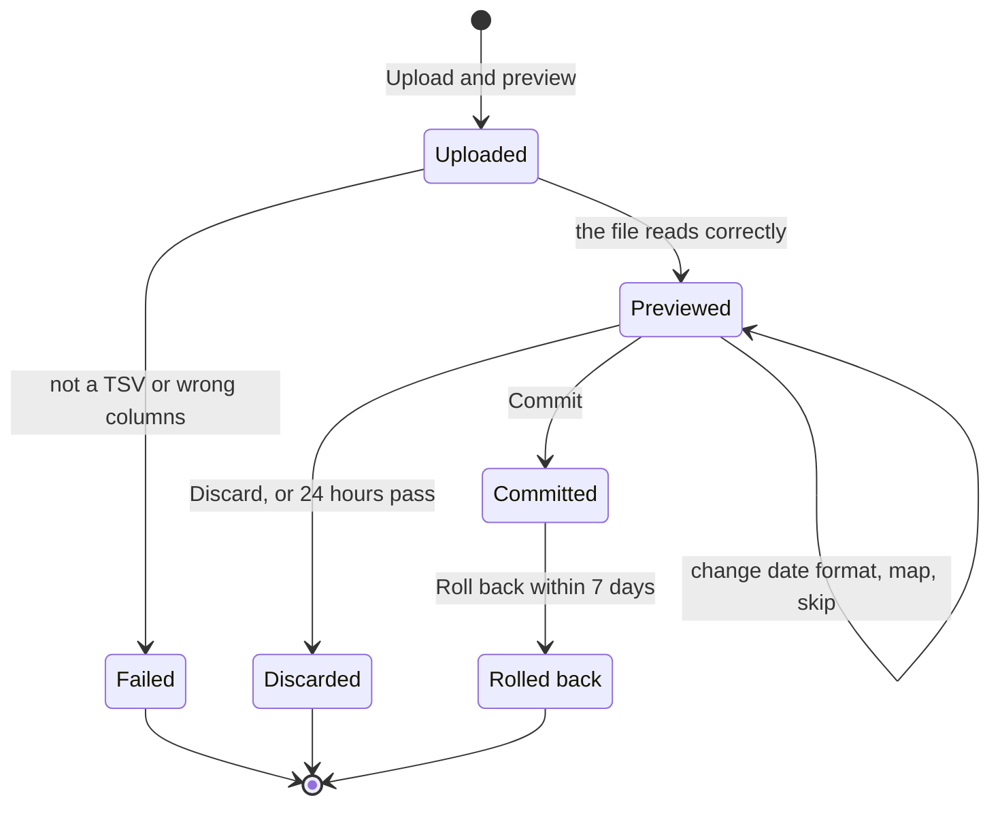

# Settings

The Settings tab, grouped as in Money Manager's settings: budget, lists, automation, data, display and account. It includes the Money Manager import, and two platform screens, API tokens and the data export, which `libs/ui` provides (FR-14). Shared parts are in the [README](README.md#shared-patterns).

Every saved change to budget items, income rules, payday, holidays, accounts, categories, currencies and rules writes an audit entry with the before and after values (FR-13, NFR-12).

## UI-FIS-30 Settings

The index of settings, each row with a one-line status.

- **Route:** `/settings`
- **Reached from:** the Settings tab, the palette
- **Offline:** the list shows. The pages behind it open read-only
- **Stories:** US-15, FR-07

**Layout**

| Group | Row | Status line, for example | Opens | Source |
| --- | --- | --- | --- | --- |
| (first, on its own) | Review | "3 transactions to confirm or trash", with the count badge, or "Nothing to review" | UI-FIS-07 | FR-23, FD-29 |
| Budget | Budget items | "10 items", or "Amounts not set" | UI-FIS-31 | US-15 |
| Budget | Pay cycle | "Day 25 · next payday Fri 23 Oct", or "Not set" | UI-FIS-32 | BR-10 |
| Budget | Holidays | "2026 listed · 2027 missing" | UI-FIS-33 | FR-30 |
| Lists | Accounts | "9 accounts" | UI-FIS-20 | FR-17 |
| Lists | Categories | "Expense and income categories" | UI-FIS-25 | FR-17 |
| Lists | Currencies | "IDR only", or "IDR + USD" | UI-FIS-34 | A-11 |
| Automation | Recurring | "2 active" | UI-FIS-35 | US-17 |
| Automation | Auto-categorise rules | "3 rules" | UI-FIS-36 | US-16 |
| Data | Import from Money Manager | "Not imported yet", or "Last import 9 Oct 2026" | UI-FIS-40 | US-07 |
| Data | Trash | "37 transactions" | UI-FIS-08 | AC-10.2 |
| Data | API tokens | "2 active" | UI-CORE-04 | US-03 |
| Data | Export all data | "One ZIP of every module's data" | UI-CORE-05 | US-06 |
| Display | Display | "Pay cycle · Daily · System theme" | UI-FIS-37 | FD-03, FD-07, FD-22 |
| Account | Security and sessions | "Passkeys, authenticator app, recovery codes, devices" | the platform's security screens, mounted here but outside this doc | FR-03, FR-04 |
| Account | Sign out | — | ends this session | FR-03 |

**States**

| State | What you see | Source |
| --- | --- | --- |
| First run | "Start with your pay cycle", with Set up (→ UI-FIS-32). The status lines show what is still missing | EC-21, Proposed |
| Offline | The list, under the Offline banner | NFR-16 |

**Interactions**

| # | Element | Action | What happens next | Source |
| --- | --- | --- | --- | --- |
| 1 | Any row | Click | Opens the screen in its Opens column | Proposed |
| 2 | Sign out | Click | Ends this device's session and opens UI-CORE-01 | FR-03 |

**Leads to:** every screen in the table above.

## UI-FIS-31 Budget items

The budget items and their amounts, projection types and rules, plus the afford check's buffers.

- **Route:** `/settings/budget-items`
- **Reached from:** Settings, Edit budget on UI-FIS-12, Edit item on UI-FIS-13, the "Budget exceeds income" warning
- **Offline:** read-only
- **Stories:** US-15, AC-15.1, AC-15.3, AC-15.4, BR-14 to BR-16, BR-22, BR-23, BR-25, EC-10, FR-17, FR-29

**Layout**

1. The line "Changes apply to the open cycle and later ones. Closed cycles keep the settings they closed with." (BR-23)
2. The items in display order, the same order as on Budget. Each shows its name, 🔒 Locked or Flexible, its projection type, its amount, and what it counts ("Makan, Jajan", or "Transfers to Stockbit, Pluang").
3. A footer: "Total budget Rp … · Expected income this cycle Rp …". When the total is the larger, the warning "Budget exceeds income by Rp X" appears (EC-10).
4. + Add item.
5. Afford check buffers: One-off buffer, 1.15 by default; Monthly buffer, 1.5 by default; Save (BR-22).

At install, the items are seeded with an amount of 0 for the owner to fill in (FR-17):

- Locked: Makan, Kos, Investasi and Alokasi darurat.
- Flexible: Jajan, Laundry, Obat & Kesehatan, Belanja barang-barang and Transportasi.
- Lain-lain catches everything else.

Only Investasi comes with a rule, transfers to Stockbit or Pluang (BR-14). The others show "Counts nothing yet" until categories are chosen, and until then their expenses count under Lain-lain.

**Item form** (a dialog)

| Field | Rules | Source |
| --- | --- | --- |
| Name | Required, unique among items | Proposed |
| Amount | Whole rupiah, 0 or more | BR-25, AC-15.4 |
| Projection type | One of five, each shown with its rule. With d = days so far including today and D = days in the cycle: Daily, spent ÷ d × D; Weekly, spent ÷ ⌈d ÷ 7⌉ × (D ÷ 7); Fixed, the larger of spent and budget; Minimum, the larger of spent and a minimum; Reserve, the budget. Minimum adds a Minimum amount field | BR-15, BR-25 |
| Kind | Locked, which reserves at least its budget, or Flexible, which reserves its projection | BR-16, BR-25 |
| Counts these categories | Expense categories and subcategories. One already counted by another item shows "Used by Makan" and can't be picked | BR-14, FD-13 |
| Counts transfers to | Accounts, for example Stockbit and Pluang | BR-14 |

**Interactions**

| # | Element | Action | What happens next | Source |
| --- | --- | --- | --- | --- |
| 1 | + Add item | Click | Opens the item form, empty, with Daily and Flexible chosen | Proposed |
| 2 | Item row | Click | Opens the item form for that item | Proposed |
| 3 | Item form › Save | Click | Saves it and closes the form. The toast reads "Saved. Applies to this cycle (from 25 Sep 2026) and later. Closed cycles keep their snapshot." Budget figures for the open cycle change at once. An audit entry is written | BR-23, AC-15.1, FR-29, FR-13 |
| 4 | Item form › Save | The budgets now add up to more than the cycle's income | Saves anyway, and the toast reads "Budget exceeds income by Rp X" | AC-15.3, EC-10 |
| 5 | Item form › Save | The amount is negative | Refused. "Amount can't be negative" shows under Amount | AC-15.4, BR-25 |
| 6 | Item form › Save | The name or projection type is missing | Refused, naming the field | BR-25 |
| 7 | Item form › Delete | Click | Dialog: "Delete Jajan? From this cycle on, its expenses count under Lain-lain. Closed cycles keep it." Delete removes it from the open cycle on, and an audit entry is written | BR-23, BR-14, Proposed |
| 8 | Item form › Cancel | Click, or Esc | Closes the form. Unsaved changes ask "Discard changes?" first | Proposed |
| 9 | Item row | Drag, or ⋯ › Move up and Move down | Changes the order on this list and on Budget | NFR-18, Proposed |
| 10 | Lain-lain row | Click | Opens it read-only: "Catches expenses no other item counts. Budget Rp 0, flexible." | BR-14, FD-13 |
| 11 | Buffers › Save | Click | Saves both buffers, and the next afford check uses them. A value below 1 is refused with "A buffer must be 1 or more". An audit entry is written | BR-22, FR-13, Proposed |

**Leads to:** UI-FIS-12.

## UI-FIS-32 Pay cycle

The payday rule and the income lines that drive every cycle's dates and income.

- **Route:** `/settings/pay-cycle`
- **Reached from:** Settings; "Set your payday rule first" on Budget or Afford check; the "Set your payday rule to see pay cycles" prompt; Set income on Budget
- **Offline:** read-only
- **Stories:** US-15, BR-10 to BR-12, BR-23, AC-13.4, AC-15.1, EC-09, FR-29

**Layout**

1. Payday rule: "Payday is day [25] of each month, moved to the previous working day when it falls on a weekend or a holiday." (BR-10). Until it is saved, it reads "Not set yet", and 25 is suggested in the field.
2. The next three paydays, each with its reason. For example: "Fri 23 Oct 2026 (25 Oct is a Sunday)", then "Wed 25 Nov 2026", then "Thu 24 Dec 2026 (25 Dec is a holiday)", the last only if 25 Dec is in the holiday list.
3. Income: your income lines, each a name and an amount per cycle, such as a salary, a business or freelance work, with + Add income line and × to remove. A negative amount is a deduction (BR-12).
4. A preview: "This cycle, Oct 2026 (25 Sep – 22 Oct): income Rp …" (BR-12).
5. Save and Cancel.

**Interactions**

| # | Element | Action | What happens next | Source |
| --- | --- | --- | --- | --- |
| 1 | Payday day | Type | The paydays preview updates as you type. Outside 1 to 28 it shows "Choose a day from 1 to 28" | BR-10, Proposed |
| 2 | An amount field | Type | Whole rupiah only. The income preview updates as you type | BR-12 |
| 3 | + Add income line | Click | Adds a row with a name and an amount. A name already in the list is refused with "An income line with this name already exists" | BR-12 |
| 4 | × on an income line | Click | Removes the row | Proposed |
| 5 | Save | No cycle dates change | Saves. The toast reads "Saved. Applies to this cycle and later. Closed cycles keep their snapshot." Income and free capacity change at once. An audit entry is written | BR-23, AC-15.1, FR-13 |
| 6 | Save | The change moves cycle dates | First a dialog lists the changes, for example "The open cycle now ends 23 Oct instead of 22 Oct. The next cycle starts 24 Oct. Transactions move to the cycle their dates fall in." Save then saves, and the toast reads "Pay cycle dates changed" | EC-09, BG-04, 4.3 |
| 7 | Save | This is the first payday rule | Saves. The cycle that holds today opens at once, earlier cycles become imported history, and the period header switches from months to pay cycles | FD-27, FD-14, FD-03 |
| 8 | Cancel | Click | Drops the changes. If anything changed, it asks "Discard changes?" first | Proposed |

**Leads to:** UI-FIS-12, UI-FIS-33.

## UI-FIS-33 Holidays

Each year's holidays, which move paydays.

- **Route:** `/settings/holidays?year=2026`
- **Reached from:** Settings; Add holidays on the "Holidays for 2027 are missing" warning
- **Offline:** read-only
- **Stories:** US-15, FR-30, A-13, AC-15.2, BR-10, BR-11, EC-08, EC-09

**Layout**

1. Year tabs: last year, this year, next year, and "Other year…".
2. On a year the next payday needs and that has no list: the warning "Holidays for 2027 are missing" (EC-08).
3. The year's holidays, each with its date, weekday and name. The list is seeded from the budgeting skill's list wherever that has the year (A-13, FR-30).
4. + Add holiday, and Paste a list.

**Interactions**

| # | Element | Action | What happens next | Source |
| --- | --- | --- | --- | --- |
| 1 | Year tab | Click | Shows that year's list | FR-30 |
| 2 | Other year… | Click | Opens a year picker, then shows the chosen year | Proposed |
| 3 | + Add holiday | Click | Adds a row with a date in this year and a name. Save on the row adds it, and the toast reads "Holiday added" | FR-30 |
| 4 | A row | Click | Makes the date and name editable, with Save and Cancel | FR-30 |
| 5 | ⋯ › Delete | Click | Removes the holiday, and the toast reads "Holiday removed" | FR-30 |
| 6 | Add, edit or delete | The change moves a payday or the open cycle's end | First a dialog lists the changes: the new payday and cycle dates. Save then saves, the toast reads "Pay cycle dates changed", and transactions move to the cycle their dates fall in | EC-09, BR-11, BG-04 |
| 7 | Add or edit | The date is outside the year | Refused with "Choose a date in 2027" | Proposed |
| 8 | Add or edit | The date is already a holiday | Refused with "25 Dec 2026 is already a holiday" | Proposed |
| 9 | Paste a list | Click | Opens a box for one holiday per line, "2027-01-01 Tahun Baru". Preview shows the parsed rows and any errors by line. Add all adds them, running the check in row 6, and the toast reads "12 holidays added" | A-13, Proposed |

Every saved change writes an audit entry (FR-13). The reminder email on 1 December is in BG-08.

**Leads to:** UI-FIS-12, UI-FIS-32.

## UI-FIS-34 Currencies

Your preferred currencies: the ones Add transaction offers, each with a rate to the base currency that you enter by hand. The base is chosen at setup, IDR by default (FD-10).

- **Route:** `/settings/currencies`
- **Reached from:** Settings; "Add a currency" in UI-FIS-22
- **Offline:** read-only
- **Stories:** A-11

**Layout**

1. The base currency, IDR by default: "Budgets, reports and afford checks are in rupiah." (A-11). Until the first transaction is saved it has Change; after that it is fixed, with "The base currency is fixed once you have transactions" (FD-10).
2. Other currencies, in the order the currency picker shows them, each with its code, its rate ("1 USD = Rp …"), when the rate last changed, and how many accounts use it.
3. + Add currency.

**Interactions**

| # | Element | Action | What happens next | Source |
| --- | --- | --- | --- | --- |
| 1 | + Add currency | Click | Dialog with Code (ISO 4217, such as USD) and Rate (rupiah for 1 unit, more than 0). Save adds it, the toast reads "Currency added", and an audit entry is written. IDR is refused with "IDR is the base currency", and an unknown code with "Use a 3-letter currency code" | A-11, FR-13, Proposed |
| 2 | Currency row | Click | Dialog to change the rate. Save stores it, and the toast reads "New transactions use the new rate. Existing ones keep the rate they were saved with." Account values shown "≈ Rp" update. An audit entry is written | FD-10, FR-13 |
| 3 | ⋯ › Remove | Click | Allowed only when no account, transaction or rule uses the currency; otherwise disabled with "Used by 1 account". The dialog "Remove USD?", then Remove, deletes it | Proposed |
| 4 | ⋯ › Move up, Move down, or drag | Click or drag | Changes the order of the currency picker on Add transaction | NFR-18, FD-10 |
| 5 | Base currency › Change (no transactions yet) | Click | Dialog listing the preferred currencies. Choosing one makes it the base, and the other rates must be entered again against it. An audit entry is written | FD-10, Proposed |

**Leads to:** UI-FIS-20, UI-FIS-22.

## UI-FIS-35 Recurring

Fixed payments such as kost rent, created for you each cycle. This is Money Manager's "Repeat" setting.

- **Route:** `/settings/recurring`
- **Reached from:** Settings; the source link on a recurring transaction
- **Offline:** read-only
- **Stories:** US-17, AC-17.1, AC-17.2, BR-33, FR-32, A-09, EC-19

**Layout**

1. The line "Each active rule creates one transaction when a pay cycle opens, dated payday. It arrives in Review." (FR-32, BR-33, A-09, FD-15)
2. The rules. Each shows its name, a type icon, its amount, its account (or From → To), its category, its status (Active, or Paused with the reason), and when it last ran: "Last created: cycle Oct 2026", or "Not run yet · first run Fri 23 Oct 2026".
3. + Add rule.

**Rule form** (a dialog): Name (required); Type (Expense, Income or Transfer); Amount (BR-01); Account, or From and To, which must differ (AC-09.3); Category › subcategory for an expense or income (BR-02); Note and Tags (BR-08).

**States**

| State | What you see | Source |
| --- | --- | --- |
| No payday rule | "Set your payday rule first", with Set payday rule (→ UI-FIS-32), because rules run when a cycle opens | AC-13.4, FR-32 |
| No rules | "Add fixed payments, like kost rent, so they're never forgotten", with + Add rule | EC-21 |
| Offline | The list, read-only | NFR-16 |

**Interactions**

| # | Element | Action | What happens next | Source |
| --- | --- | --- | --- | --- |
| 1 | + Add rule | Click | Opens the rule form, empty | Proposed |
| 2 | Rule row | Click | Opens the rule form for that rule | Proposed |
| 3 | Rule form › Save (new rule) | Click | Saves it. The toast reads "Rule saved. It first runs when the next cycle opens on Fri 23 Oct 2026." An audit entry is written | FD-15, FR-13 |
| 4 | Rule form › Save (existing rule) | Click | Saves it. The toast reads "Saved. The change applies from the next run. Transactions it already created stay as they are." | FR-32, Proposed |
| 5 | Rule form › Save | A field breaks a rule | Refused, naming the field, with the messages of UI-FIS-04 | BR-01, BR-02, BR-08, AC-09.3 |
| 6 | Pause or Resume (switch on the row) | Click | A paused rule does not run. Resuming takes effect from the next cycle | Proposed |
| 7 | ⋯ › Delete | Click | Dialog: "Delete 'Kos'? Transactions it already created stay." Delete removes it, and an audit entry is written | FR-13, Proposed |
| 8 | A rule paused by a deactivation | Look | Its status reads "Paused: account BCA is inactive", and it can be resumed only after the account or category is reactivated | BR-03, Proposed |

When a cycle opens, each active rule creates exactly one transaction, and a second run creates nothing (BG-03, AC-17.1, AC-17.2, EC-19).

**Leads to:** UI-FIS-07 (where its transactions arrive), UI-FIS-32.

## UI-FIS-36 Auto-categorise rules

Rules that fill in the category, subcategory and note of new transactions from the note text.

- **Route:** `/settings/rules`
- **Reached from:** Settings; a rule named in a "Saved" toast
- **Offline:** read-only
- **Stories:** US-16, AC-16.1 to AC-16.3, BR-32, FR-31

**Layout**

1. The line "When a transaction is created, the first rule that matches fills in its category, subcategory and note. Rules never change existing transactions." (BR-32)
2. The rules, in order. Each shows its position; its match, such as "Note contains 'warung'"; its conditions ("any account" or "BCA", "any time" or "07:00–09:00"); and its result, such as "→ Primary Needs › Makan, note 'breakfast: …'". Each also has an on/off switch.
3. + Add rule.
4. A test box with Note, Account, Time and Test.

For example, rule 1 matches "warung" between 07:00 and 09:00 and sets Primary Needs › Makan with the note "breakfast: …"; rule 2 matches "warung" at any time. A transaction at 08:10 gets rule 1. One at 13:00 gets rule 2 (AC-16.1, AC-16.2).

**Rule form** (a dialog):

- Note contains: required, and case-insensitive.
- Account, and a time window from and to in the transaction's local time: both optional.
- Set category › subcategory, and Set note: also optional, but at least one Set field is needed. The note template's syntax is FD-26.

**Interactions**

| # | Element | Action | What happens next | Source |
| --- | --- | --- | --- | --- |
| 1 | + Add rule | Click | Opens the rule form, empty. A new rule goes to the end of the list | Proposed |
| 2 | Rule row | Click | Opens the rule form for that rule | Proposed |
| 3 | Rule form › Save | Click | Saves it, and the toast reads "Rule saved". An audit entry is written. A missing match text, or no Set field, is refused, naming the field | FR-31, FR-13, Proposed |
| 4 | Rule row | Drag, or ⋯ › Move up and Move down | Changes the order, and the toast reads "Rule order saved". The first match wins | BR-32, AC-16.2 |
| 5 | On/off switch | Click | A rule that is off is skipped. Deactivating a category its result uses turns it off | BR-32, Proposed |
| 6 | ⋯ › Delete | Click | Dialog: "Delete this rule?" Delete removes it, and an audit entry is written | FR-13, Proposed |
| 7 | Test | Click | Shows which rule would match and what it would set, for example "Rule 2 matches: sets Primary Needs › Makan". With no match it reads "No rule matches. The values stay as sent." Nothing is saved | BR-32, AC-16.3, Proposed |

**Leads to:** none. The rules apply in UI-FIS-01, UI-FIS-04, BG-01 and BG-02.

## UI-FIS-37 Display

How the views look on this device.

- **Route:** `/settings/display`
- **Reached from:** Settings
- **Offline:** works. The settings are kept on the device (FD-22)
- **Stories:** NFR-18, FD-03, FD-07, FD-22

| # | Setting | Options | What happens next | Source |
| --- | --- | --- | --- | --- |
| 1 | Period | Pay cycle (default), Calendar month | From now on, Daily, Calendar, Stats › Category, Stats › Note and Account detail step through this period, and Monthly lists the year by it. A view that was on a cycle moves to the month that holds today. Budget and Budget history always use pay cycles | FD-03, FR-27 |
| 2 | Start view | Daily (default), Calendar, Monthly | Picks the view that `/` and sign-in open | FD-07 |
| 3 | Theme | System (default), Light, Dark | Changes at once, as in the user menu | NFR-18, FD-22 |

Each choice applies as soon as it is made; there is no Save button.

**Leads to:** none.

## UI-FIS-40 Imports

Every Money Manager import, with its state and its rollback deadline.

- **Route:** `/settings/imports`
- **Reached from:** Settings
- **Offline:** read-only
- **Stories:** US-07, AC-07.2, FR-16, BR-27

**Layout**

1. The line "Bring your Money Manager history in once. Rows are saved as Confirmed in one batch that you can roll back for 7 days." (FR-16, AC-07.2, BR-27)
2. Batches, newest first. Each shows when it was uploaded, its file name, its counts ("4,812 imported · 12 skipped") and a status chip:
   - "Previewed · expires 14:05 tomorrow"
   - "Committed · roll back until 16 Oct 2026"
   - "Committed · final"
   - "Rolled back", "Discarded" or "Failed"
3. New import.

**States**

| State | What you see | Source |
| --- | --- | --- |
| No imports | "Import from Money Manager to get started", with New import | EC-21 |
| Offline | The list, read-only | NFR-16 |

**Interactions**

| # | Element | Action | What happens next | Source |
| --- | --- | --- | --- | --- |
| 1 | New import | Click | Opens UI-FIS-41 | US-07 |
| 2 | Batch row | Click | Opens UI-FIS-42 | Proposed |

**Leads to:** UI-FIS-41, UI-FIS-42.

## UI-FIS-41 New import

Step 1 of 2: choose the Money Manager TSV and its date format.

- **Route:** `/settings/imports/new`
- **Reached from:** New import on UI-FIS-40; Import on Daily's first-run line; ⋯ › Import from Money Manager; the palette
- **Offline:** "Needs a connection"
- **Stories:** US-07, FR-15, BR-27, A-12, EC-17

**Layout**

1. "Step 1 of 2: Choose the file".
2. A drop zone with Choose file, taking `.tsv` and `.txt`. Once a file is chosen it shows the name and size.
3. Date format: MM/DD/YYYY (the default, A-12), DD/MM/YYYY or YYYY-MM-DD.
4. Upload and preview, and Cancel.

**Interactions**

| # | Element | Action | What happens next | Source |
| --- | --- | --- | --- | --- |
| 1 | Choose file, or drop a file | Click or drop | Shows the file's name and size. Over 10 MB it shows "Max 10 MB or 100,000 rows" at once, and Upload and preview stays disabled | BR-27 |
| 2 | Date format | Choose | Sets how the dates will be read | FR-15, A-12 |
| 3 | Upload and preview | Click | Uploads the file with a progress bar, streamed to disk on the server (NFR-05). The batch is Uploaded, and the file is kept for at most 24 hours. Then the server reads it | 4.3, NFR-05 |
| 4 | Upload and preview | The file reads correctly | The batch becomes Previewed, and UI-FIS-42 opens | 4.3 |
| 5 | Upload and preview | The file is not a TSV, or has the wrong columns | The batch Failed. The error names the line and column, for example "Line 1, column 6: expected 8 columns, found 5". The file is deleted, and Choose another file appears | 4.3 |
| 6 | Upload and preview | The file has more than 100,000 rows | Refused with "Max 10 MB or 100,000 rows" | BR-27 |
| 7 | Upload and preview | The server's disk is nearly full | Refused with "Server disk nearly full". Nothing is uploaded | EC-17 |
| 8 | Choose another file | Click | Back to step 1, keeping the date format | Proposed |
| 9 | Cancel | Click | Returns to UI-FIS-40 | Proposed |

**Leads to:** UI-FIS-42, UI-FIS-40.

## UI-FIS-42 Import batch

Step 2 of 2: check everything the file holds before anything is saved, then commit or discard. After a commit, the same page shows the result and offers the rollback.

- **Route:** `/settings/imports/:id`
- **Reached from:** Upload and preview; a batch row on UI-FIS-40; the source link on an imported transaction
- **Offline:** read-only
- **Stories:** US-07, AC-07.1 to AC-07.4, FR-15, FR-16, BR-03, BR-05, BR-07, BR-27, EC-05, EC-06

**Layout while Previewed**

1. A summary: the rows by type (Expense, Income, Transfer), the date range, and the totals per account (AC-07.1).
2. Dates check: the first 10 rows' dates as written and as read, such as "10/03/2026 → 3 Oct 2026". Dates in the future, and day-month swaps it can detect, are flagged with "Check the date format". A Date format menu with Re-parse sits beside them. Rows carry dates without times, and each date is used as it is (FR-15, EC-06, BR-05).
3. Unknown accounts and categories: each unknown value with its row count and line numbers. Each one gets "Map to…", "+ New account" or "+ New category", or "Skip these rows" (AC-07.1, AC-07.4, FD-19).
4. Row errors: each with its line number and reason, such as an amount outside BR-01, a note over 200 characters (BR-08), an inactive account (BR-03), or a date that does not read. Each has Skip row (AC-07.4).
5. Possible duplicates: "12 possible duplicates will be skipped". A list shows each row and the transaction it matches, with Import anyway on each row (BR-07, EC-05).
6. Transfers: a `Transfer-Out` row becomes a transfer from its Account to the account named in its Category, shown as "BCA → Wallet.ovo" (AC-07.3). The Description column goes to each transaction's Description (FD-24). How `Transfer-In` rows are handled waits on FD-23.
7. A footer: "Commit 4,812 transactions", disabled while rows need fixing with "Resolve 3 rows first", plus Discard and "This preview expires at 14:05 tomorrow."

Long lists in the preview show 200 rows at a time.

**States**

| State | What you see | Source |
| --- | --- | --- |
| Uploaded, being read | "Reading the file…" | 4.3 |
| Previewed | The preview above | 4.3, AC-07.1 |
| Committed, within 7 days | "4,812 imported · 12 duplicates skipped · 3 rows skipped" and "You can roll back until 16 Oct 2026", with Roll back and View transactions | FR-16, BR-27 |
| Committed, after 7 days | The same counts, and "Final. The rollback window closed on 16 Oct 2026." | 4.3, BR-27 |
| Rolled back | "Rolled back on 12 Oct 2026. Its 4,812 transactions went to Trash.", with Open Trash | 4.3 |
| Discarded | "Discarded. The file was deleted." After expiry instead: "This preview expired. Upload the file again." Both have New import | 4.3, BG-06 |
| Failed | The read error with its line and column, and New import | 4.3 |

**Interactions**

| # | Element | Action | What happens next | Source |
| --- | --- | --- | --- | --- |
| 1 | Date format, then Re-parse | Click | Reads the stored file again with the new format. The whole preview refreshes, keeping mappings and skips wherever the rows still match | FR-15, EC-06, FD-19 |
| 2 | Map to… | Choose an account or category | Every row with that value becomes valid, and the Commit count updates | AC-07.4 |
| 3 | + New account, + New category | Click | Opens UI-FIS-22, or a category name field. Once it is saved, the unknown value is mapped to it | FD-19 |
| 4 | Skip these rows | Click | Leaves those rows out, counted as skipped | AC-07.4 |
| 5 | Skip row | Click | Leaves that row out | AC-07.4 |
| 6 | Import anyway | Click | Includes that duplicate. The line now reads "11 possible duplicates will be skipped" | BR-07, EC-05 |
| 7 | Commit | Click | Dialog: "Import 4,812 transactions? You can roll back this batch until 16 Oct 2026." Import saves every row as Confirmed in one database transaction, as one batch. The page shows the Committed result, the toast reads "4,812 transactions imported", and an audit entry is written | AC-07.2, FR-16, FR-21, FR-13 |
| 8 | Discard | Click | Dialog: "Discard this import? The file will be deleted." Discard marks it Discarded, deletes the file and returns to UI-FIS-40, where the toast reads "Import discarded" | 4.3 |
| 9 | Roll back | Click, within 7 days of the commit | Dialog: "Move the 4,812 transactions from this import to Trash? You can restore single transactions from Trash for 30 days." Roll back marks the batch Rolled back and moves its transactions to Trash. An audit entry is written | FR-16, 4.3, FR-13 |
| 10 | Roll back | After 7 days | Not offered. The page reads "Rollback window closed" | BR-27 |
| 11 | View transactions | Click | Opens UI-FIS-06 filtered to this import as the source | FD-16 |
| 12 | Open Trash | Click | Opens UI-FIS-08 | Proposed |
| 13 | New import | Click | Opens UI-FIS-41 | Proposed |

**Leads to:** UI-FIS-06, UI-FIS-08, UI-FIS-22, UI-FIS-40, UI-FIS-41.

## UI-CORE-04 API tokens

Scoped, expiring tokens for scripts and agents that use Fiscus. This is a platform screen from `libs/ui`, shown here with the `fiscus` scopes.

- **Route:** `/settings/tokens`
- **Reached from:** Settings › API tokens, a token's name on a transaction, "New API token" in the palette
- **Offline:** read-only
- **Stories:** US-03, AC-03.1 to AC-03.3, BR-28, FR-06, PRD 2.2 and 4.3, EC-13

**Layout**

1. The line "Tokens let scripts, agents and your phone use Fiscus. Read, write and settings work only on your tailnet. Ingest works only on the public endpoint, `POST /ingest/v1/transactions` on your domain, and can't read anything." (2.2, FR-26)
2. The tokens: name, scopes, status, expiry date, last used and created. Status is Active, "Expires in 6 days", Expired or Revoked (AC-03.1, FR-06).
3. A "Show expired and revoked" switch, + New token, and Pair a phone (Phase 3). A paired phone's token is listed like any other, named after the phone (FR-34).

**New token dialog**

| Field | Rules | Source |
| --- | --- | --- |
| Name | Required | BR-28 |
| Scopes | "Read (`fiscus:read`)", "Write (`fiscus:write`)", "Settings (`fiscus:settings`)" and "Ingest (`fiscus:ingest`)". At least one. Settings covers accounts, categories, tags, currencies, templates, budget items, rules and the budget settings (PRD 2.2). Ticking ingest clears and disables the others, with "Ingest tokens can't have other scopes" | BR-28, FD-01, FD-21 |
| Expiry | 30, 90 or 365 days, or a date at most 365 days ahead | BR-28 |

**Interactions**

| # | Element | Action | What happens next | Source |
| --- | --- | --- | --- | --- |
| 1 | + New token | Click | Opens the new token dialog | US-03 |
| 2 | Create | Click | With no name, no scope, or an expiry more than 365 days away, it is refused, naming the field. Otherwise the token is created Active, and a dialog shows its value once: "Copy this token now. You won't see it again." An audit entry is written | BR-28, AC-03.1, FR-13 |
| 3 | Copy | Click | Copies the value, and the button reads "Copied" | Proposed |
| 4 | Done | Click | Closes the dialog. From then on, the list shows only the token's name, scope, expiry and last-used time | AC-03.1 |
| 5 | Revoke (row) | Click | Dialog: "Revoke 'phone-shortcut'? Calls using it fail from now on. Transactions it created stay." It has two buttons: Revoke, and Revoke and review what it created. Either one revokes the token, which can never come back, and writes an audit entry | 4.3, 2.2, AC-03.2 |
| 6 | Revoke and review what it created | Click | Revokes as in row 5, then opens UI-FIS-07 with "Trash all from this token since a date" open for this token | EC-13, FD-18 |
| 7 | Create a replacement (expired or revoked row) | Click | Opens the new token dialog with the old name and scopes filled in. A token is renewed by creating a new one | 4.3 |
| 8 | Show expired and revoked | Switch | Shows or hides those tokens | Proposed |
| 9 | Pair a phone | Click | Opens UI-CORE-06, which shows a one-time code as a QR code for the phone app to scan ([phone-app.md](phone-app.md)) | FR-34, US-19, BR-37 |

Last used is updated at most once a minute (FR-06). A revoked or expired token gets 401, and a `fiscus:read` token that tries to create gets 403 (AC-03.2, AC-03.3, BG-02). The expiry warning email is in BG-09.

**Leads to:** UI-FIS-07, UI-CORE-06.

## UI-CORE-05 Data export

One ZIP of every module's data, in open formats. This is a platform screen from `libs/ui`.

- **Route:** `/settings/export`
- **Reached from:** Settings › Export all data, the palette
- **Offline:** "Needs a connection"
- **Stories:** US-06, AC-06.1, AC-06.2, FR-12, NFR-15

**Layout**

1. The line "One ZIP with CSV and JSON for each module, and a manifest of row counts. The file is kept for 24 hours." (FR-12)
2. The status area (below), and Export all data.

**States**

| State | What you see | Source |
| --- | --- | --- |
| Idle | Export all data | FR-12 |
| Running | "Export started at 10:42. You can leave this page." The button is disabled with "An export is already running" | AC-06.2 |
| Ready | "Download ZIP (12 MB) · expires 10:47 tomorrow" | AC-06.1, FR-12 |
| Failed | "The export failed.", with Try again | Proposed |
| Expired | "Your last export expired.", with Export all data | FR-12, NFR-15 |

**Interactions**

| # | Element | Action | What happens next | Source |
| --- | --- | --- | --- | --- |
| 1 | Export all data | Click | Starts the export job (BG-12), and the status reads Running. While the page is open, it checks the status every 5 seconds. An audit entry is written | FR-12, Proposed |
| 2 | Export all data | Another export is running, for example from another tab | Refused with "An export is already running" | AC-06.2 |
| 3 | Download ZIP | Click | The browser downloads the ZIP | AC-06.1 |
| 4 | Try again | Click | Starts a new export, as in row 1 | Proposed |

**Leads to:** none.
