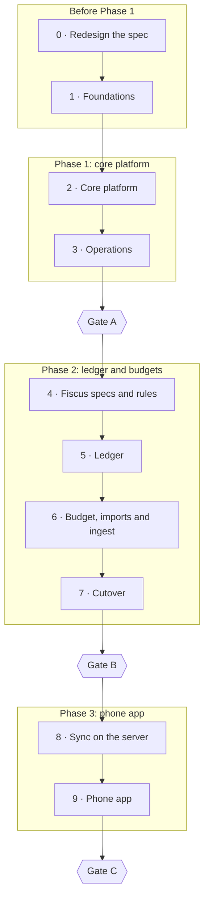

# Implementation plan

What gets built, in what order, and what the owner signs off before each next
step. The [PRD](prd/README.md) says what to build and the
[architecture guide](architecture/README.md) says where each piece goes. This
page splits the build into stages, says what each one delivers, and shows
where the project is now.

This plan replaced `docs/tasks/` on 11 Oct 2026. Its work items are the old
tasks, shortened, and the T- task ids are no longer used.

## Where the project is

Updated 15 Oct 2026.

- **Stage 0, Redesign the spec: signed off 15 Oct 2026.**
- **Stage 1, Foundations: in progress.** 7 of 14 work items done. The
  tooling is done; the data layer and the first deploy are left.
- **Lately:**
  - 15 Oct 2026:
    - The workspace and the docs committed on `dev`, and Stage 0 signed off.
    - The 9 projects scaffolded, with `bun run boundaries` and
      `bun run secrets` in CI and the boundary rules tightened. `apps/api`
      answers `/health`, and `apps/fiscus-web` builds to 69 KB gzipped.
    - **You:** SWC pinned to 1.15.8, because 1.16 refuses to load its
      native binary on the development machine
      ([tech stack](architecture/tech-stack.md#tooling-and-quality)).
  - 12 Oct 2026:
    - The app flow and the phone design revised. The web app's offline
      queue and install prompt are gone, BG-07 is now the phone app's sync,
      and [phone-app.md](design/app-flow/phone-app.md) maps every screen
      into the phone app and names its own (UI-CORE-06, UI-FIS-50 to
      UI-FIS-54).
    - The architecture guide, the tech stack and PRD 5.4 revised: the phone
      app in `apps/fiscus-mobile/`, sync on the server, the shared test
      cases, and the phone's packages as Proposed.
    - The [PRD](prd/README.md) revised to v1.1, with the `fiscus:settings`
      scope for the phone's token.
    - ADR-0002 accepted, the phone app's stories
      [US-19 to US-24](user-story/phone-app.md), and [Gate C](#gate-c)
      confirmed for Android with a pay cycle of real use.
  - Earlier: Flutter (Q-07), TypeScript for the server (Q-01), the database
    design, Phase 3, no PWA (Q-08), and this plan.
- **Next:** the data layer: PostgreSQL 18 for development, then `libs/db`.
- **Waiting on you:** a private GitHub repo for CI, and the host, before
  Stage 1's deploy items. FD-31 is open for Stage 9, and the Stage 2
  decisions can be answered early.
- **The code:** the 9 TypeScript projects of PRD 5.4, with no features
  yet. The phone app waits for Stage 9. The repo has no remote yet, so CI
  has not run; its steps pass locally.

## Stages

| Stage | Phase | Delivers | Work done | Ends at | Status |
| --- | --- | --- | --- | --- | --- |
| [0 Redesign the spec](#stage-0-redesign-the-spec) | — | The spec revised for the Flutter app and for no PWA | 13 of 13 | Spec accepted | Signed off 15 Oct 2026 |
| [1 Foundations](#stage-1-foundations) | Before Phase 1 | The workspace's projects, the data layer, CI with PostgreSQL, and the first deploy from CI | 7 of 14 | First deploy | In progress |
| [2 Core platform](#stage-2-core-platform) | 1 | Sign-in, recovery, tokens, jobs, the module registry, the app shell and the palette | 0 of 26 | Sign-in works | Not started |
| [3 Operations](#stage-3-operations) | 1 | Backups, alerts, the restore test, the System page, the full export and the restore runbook | 0 of 6 | Gate A | Not started |
| [4 Fiscus specs and rules](#stage-4-fiscus-specs-and-rules) | 2 | The `fiscus` schema, API and contracts, the seed, every domain rule with its tests, and design Pass 2 | 0 of 14 | Rules proven | Not started |
| [5 Ledger](#stage-5-ledger) | 2 | Accounts, transactions, review, trash and quick entry, on a computer and in the phone layout | 0 of 8 | Ledger works | Not started |
| [6 Budget, imports and ingest](#stage-6-budget-imports-and-ingest) | 2 | Budget and afford, the Money Manager import, rules, recurring transactions, reports and public ingest | 0 of 11 | Feature complete | Not started |
| [7 Cutover](#stage-7-cutover) | 2 | The performance check, the real migration and the switch from Money Manager | 0 of 3 | Gate B | Not started |
| [8 Sync on the server](#stage-8-sync-on-the-server) | 3 | Push, pull, tombstones and device pairing, with a sync test suite | 0 of 6 | Sync proven | Not started |
| [9 Phone app](#stage-9-phone-app-flutter) | 3 | The offline-first Flutter app, Android first | 0 of 12 | Gate C | Not started |

## How it works

1. **One stage at a time.** A stage is signed off when its work is done and
   every item of its sign-off is ticked. Only then does the next stage
   start. Stages 3, 7 and 9 end at a gate, which also needs
   [Every gate needs](#every-gate-needs). A gate closes its phase, and
   nothing from the next phase starts early (PRD 1.3).
2. **Work runs top to bottom.** Items with no dependency between them can run
   side by side. For example, the `deploy/` items can run beside the data
   layer in Stage 1, and the design system beside the sign-in work in
   Stage 2.
3. **Docs may run ahead.** A spec, a review or one of your decisions may be
   done before its stage. Code waits for its stage. That is why Stage 1's
   decisions are already done.
4. **Specs come before code.** Each schema and set of API requirements is
   reviewed before the first migration or endpoint that needs it (Stages 2
   and 4).
5. **Fiscus runs in vertical slices:** a domain rule, then its endpoints,
   then its screen, so each slice can be used and checked on its own.
6. **Keeping it current.** The commit that does a work item ticks it
   (`- [x]`). The same commit updates the [stage table](#stages) and
   [Where the project is](#where-the-project-is). Sign-off items work the
   same way. A signed-off stage shows its date in the Status column. Commit
   footers cite the stage and the requirement ids, for example
   `Refs: Stage 2, BR-09`.
7. **Changing the plan.** Add a work item where it belongs in the order. To
   drop one, strike it through and add one line saying why. Stages are never
   renumbered. When a decision changes the plan, update the plan and the
   spec it cites in the same commit.

### Every gate needs

Gates A and B are derived from the PRD, because its roadmap diagram is not in
the repo. You confirmed them on 4 Oct 2026. Gate C is derived from
[ADR-0002](architecture/decisions/0002-offline-first-mobile-app.md), and you
confirmed it on 12 Oct 2026. Each gate also needs all of these:

- every **Must** story of the phase meets its acceptance criteria, checked by
  tests where possible ("Must stories gate their phase",
  [user stories](user-story/README.md))
- CI green on `main`, and the release deployed from CI (NFR-20)
- Fiscus idle RSS ≤ 180 MB on systemd accounting (NFR-01, PRD 1.2)
- no out-of-memory kills since the last gate (PRD 1.2)
- the [decisions](#your-decisions) due by then are answered

## Stage 0: Redesign the spec

Before Phase 1. Make the spec fit an offline-first Flutter app with sync
(ADR-0002), a TypeScript server (Q-01) and a web app with no PWA (Q-08),
before any code is written.

### Work

- [x] **You:** Q-07, the phone app is Flutter (11 Oct 2026)
- [x] **You:** Q-01, the server and the web app stay TypeScript (11 Oct 2026)
- [x] The [database design](database/README.md) for `core` and `fiscus`,
      with the sync columns, triggers and tombstones (ADR-0002 action 2,
      11 Oct 2026)
- [x] **You:** the phone app is Phase 3, after Gate B (ADR-0002 action 8,
      11 Oct 2026)
- [x] **You:** Q-08, no PWA. On a phone, Fiscus is the web app with its
      phone layout, online (11 Oct 2026)
- [x] This plan, which replaces `docs/tasks/` (11 Oct 2026)
- [x] The PRD revised (ADR-0002 action 8). PRD v1.1, 12 Oct 2026:
  - the native app's stories and FRs: [US-19 to US-24](user-story/phone-app.md)
    and FR-34 to FR-44
  - Phase 3 in 1.3, with the roadmap placeholder replaced by a link to this
    plan
  - the PWA removed from 1.3, FR-14, FR-19, NFR-16, NFR-17 and AC-08.3
    (Q-08)
  - offline use and installing restated for the native app
  - the status line updated
  - added on the way: **You:** the phone's token gets a new
    `fiscus:settings` scope (PRD 2.2, 12 Oct 2026)
- [x] ADR-0002 amended for Q-08: decision 8, and action 6, which has no PWA
      queue left to move. Then **You:** accept it (action 1). Accepted
      12 Oct 2026
- [x] The architecture guide, the [tech stack](architecture/tech-stack.md)
      and PRD 5.4 revised (12 Oct 2026):
  - where the Flutter code lives: `apps/fiscus-mobile/`, in this repo
  - its packages as Proposed (action 7)
  - `vite-plugin-pwa` and `idb-keyval` dropped
  - the format of the shared test cases, in `modules/fiscus/domain/cases/`,
    and the sync fixtures in `modules/fiscus/contracts/fixtures/`
    ([architecture guide](architecture/README.md#shared-test-cases),
    ADR-0002 §6)
  - the "v1" banners removed
- [x] The [app flow](design/app-flow/README.md) and the
      [phone design](design/mobile/README.md) revised (12 Oct 2026):
  - the install and offline parts leave the web flow (Q-08). BG-07 is now
    the phone app's sync, and the Install app row is hidden in the design
    library's user menu and gone from the prototype
  - the phone frames become the web app's phone layout
  - how much of them the Flutter app reuses is decided: all of them, with
    the same tokens (FD-30). [phone-app.md](design/app-flow/phone-app.md)
    maps each screen and names the app's own screens, which Stage 9 designs
- [x] Stages 8 and 9 checked against the native app's new stories and FRs
      (12 Oct 2026)
- [x] **You:** confirm the [Gate C](#gate-c) checklist. Confirmed 12 Oct
      2026: Android only, plus one pay cycle of real use
- [x] The docs committed, and tracked in git from here on (PRD 5.4,
      15 Oct 2026)

### Sign-off: spec accepted

- [x] The PRD's status no longer says "Being revised", and no doc carries a
      "v1" banner (12 Oct 2026)
- [x] ADR-0002 is Accepted (12 Oct 2026)
- [x] You have read Stages 1 to 9 as revised and agree with them
      (15 Oct 2026)

## Stage 1: Foundations

Before Phase 1. Settle the workspace, the data layer, CI and the first
deploy, so that every later item is tested on a real PostgreSQL and shipped
from CI.

### Work

**Decisions, done ahead**

- [x] **You:** settle multi-currency. IDR is the base currency, and other
      currencies use rates entered by hand (A-11, PRD 1.3)
- [x] **You:** accept [ADR-0001](architecture/decisions/0001-module-internal-architecture.md)
      (4 Oct 2026)
- [x] **You:** sign off the libraries for foundations and Phase 1, each
      measured first ([tech stack](architecture/tech-stack.md), NFR-01,
      NFR-22; 4 Oct 2026)
- [x] **You:** confirm Gates A and B (PRD 1.3; 4 Oct 2026)

**Tooling**

- [x] Scaffold the PRD 5.4 projects, each with one `scope:` and one `type:`
      tag. The phone app waits for Stage 9 (15 Oct 2026):
  - `bun run boundaries` and `bun run secrets`
  - CI's `verify` job runs the boundary check, type check, lint and tests
  - (PRD 5.4, ADR-0001, NFR-10, NFR-20)
- [x] Tighten the boundary rules (ADR-0001 action 1, tech-stack follow-up 1,
      15 Oct 2026, with the scaffold):
  - `contracts` imports no framework
  - `pg`, `nodemailer` and `@simplewebauthn/server` count as server
    packages
  - each rule has a test
- [x] Pin the Bun version: CI installs the version in `packageManager`
      (tech-stack follow-up 2)

**Data layer**

- [ ] PostgreSQL 18 for development (NFR-10, PRD 5.1):
  - `.env.example` lists `DATABASE_URL`, `HOST` and `PORT`
  - the API reads its configuration from the environment
- [ ] `libs/db` (PRD 5.1, PRD 5.4):
  - a `pg` pool of 5 and a Drizzle client
  - a migration runner that applies each module's `migrations/` in order
    and does nothing when run a second time
- [ ] PostgreSQL 18 in CI, with the `api` tests run against it (ADR-0001
      action 4). A one-module change still finishes in 5 minutes or less
      (NFR-21)

**First deploy**

- [ ] The host runbook takes a fresh LXC host to ready (NFR-08, PRD 5.3,
      A-01):
  - PostgreSQL 18 with 160 MB shared buffers and 20 connections
  - SSH by key only, and daily security updates
  - Tailscale
  - `/srv/fiscus/.env` at mode 0600
- [ ] The systemd unit and `tailscale serve` to 127.0.0.1:3000 (FR-01,
      NFR-01, NFR-10). The unit sets MemoryHigh 224 MB and MemoryMax 256 MB,
      with the sandboxing from `apion.service`
- [ ] Deploy from CI (NFR-06, NFR-20). A green push to `main`:
  - ships `dist/`
  - runs the migrations
  - restarts the unit in 10 s or less and polls `/health`

  The host never builds.
- [ ] The memory baseline: idle RSS of Fiscus, PostgreSQL and Tailscale from
      systemd accounting (NFR-01, NFR-02)

### Sign-off: first deploy

- [ ] A push to `main` that passes `verify` goes live on the host, and
      `/health` answers over the tailnet
- [ ] Nothing answers from outside the tailnet (FR-01)
- [ ] A boundary break or a committed secret fails CI (NFR-10)
- [ ] CI finishes in 5 minutes or less for a one-project change (NFR-21)
- [ ] The idle RSS baseline is written in `deploy/README.md` (NFR-01)

## Stage 2: Core platform

Phase 1. Build the platform that every module plugs into, and the web app's
shell: sign-in, tokens, jobs, the registry and the palette. It covers
[US-01 to US-04](user-story/core-platform.md).

### Work

**Specs first**

- [ ] **You:** the Phase 1 decisions:
  - the SMTP relay (Q-04)
  - the backup target (A-06)
  - the server timezone (A-10)
  - the recovery approach (A-03)
  - alert email (A-07)
- [ ] Review the `core` schema against the PRD
      ([core.dbml](database/core.dbml), drafted 11 Oct 2026). It covers
      FR-02 to FR-13, BR-09, BR-28 and BR-29
- [ ] Write the core API requirements in `docs/api-requirement/` (FR-02 to
      FR-13, BR-09):
  - every endpoint, with its actor, request, response, errors and audit
    entries
  - CSRF protection
  - the conventions every module follows: JSON, errors, idempotency,
    pagination, audit and logs

**Platform plumbing**

- [ ] Core migrations: Drizzle tables in `pgSchema('core')`, generated by
      `drizzle-kit`, with the [hand-written SQL](database/README.md#hand-written-sql)
      copied in (FR-07, PRD 5.4)
- [ ] The Clock, Mailer and FileStore ports. FileStore streams uploads and
      refuses them when disk use passes 85% (ADR-0001 action 2, NFR-05,
      EC-17)
- [ ] Errors and validation (ADR-0001 action 3, EC-16):
  - a `zod/mini` pipe returns 400 or 422 with `violations`
  - a rule violation is 422 and a clash with stored data is 409
  - a database outage is 503 with `Retry-After: 30`
  - errors never echo the input
- [ ] Logging: one JSON line per request, never with bodies, query strings,
      notes or file names, and a test that proves it. journald keeps 14 days
      (NFR-11)
- [ ] The audit log service, which writes inside the caller's database
      transaction (FR-13, NFR-12)
- [ ] The settings store: namespaced by module, with `server_timezone`
      defaulting to Asia/Makassar, and every change audited (BR-34, A-10)

**Sign-in and access**

- [ ] The owner account, a password hashed with argon2id, and TOTP, with the
      lockout after 5 failures in 15 minutes (FR-02, BR-29, AC-01.2)
- [ ] Sessions with a 30-day cookie, CSRF protection, and a global guard
      that refuses every route not marked public (FR-03)
- [ ] Passkeys: register several, sign in with one, remove one (FR-02,
      AC-01.1)
- [ ] Recovery codes and the server reset command (FR-04, FR-05, EC-20,
      AC-02.1 to AC-02.3)
- [ ] API tokens (FR-06, BR-28, PRD 4.3, AC-03.1):
  - a name, scopes and an expiry of at most 365 days
  - the value shown once and stored hashed
  - the states Active, Expired and Revoked
- [ ] Token auth and scopes: 401 and 403, the private and ingest surfaces,
      and the last-used time (FR-06, PRD 2.2, AC-03.2, AC-03.3)
- [ ] The idempotency interceptor (BR-09, NFR-13, EC-03):
  - a repeated request gets the stored response back
  - `idempotency_key_reused` and `idempotency_key_in_flight`
  - keys are kept for 24 hours, saved in the create's own transaction
- [ ] Rate limits: 600 a minute per token on the private API and 60 for
      ingest, with 429 and `Retry-After` (NFR-14, BR-31)
- [ ] The job queue and scheduler (PRD 5.1, BR-34, NFR-12, NFR-15):
  - pg-boss in the `pgboss` schema
  - jobs can be enqueued inside a transaction
  - schedules run in `server_timezone`
  - core housekeeping jobs
- [ ] The event bus, which publishes only after commit (PRD 5.2)
- [ ] The module registry (FR-07, AC-04.2, ADR-0001 action 5):
  - the manifest's web half holds data only
  - its api half holds scopes, migrations, jobs, settings and an export hook
  - a disabled module registers nothing

**Shell and screens**

- [ ] The design system in `libs/ui` (NFR-18, NFR-19):
  - CSS Modules
  - light and dark themes at WCAG 2.2 AA
  - amounts as "Rp 25.000" and dates as "29 Sep 2026"
- [ ] The shell kit and the web runner `apps/fiscus-web` (FR-14, NFR-03,
      NFR-22, Q-08):
  - routes and navigation from the manifests
  - module screens loaded lazily
  - the phone layout below 1024 px
  - a first load of 200 KB gzipped or less, checked in CI, and 2 s or less
    on Fast 4G
- [ ] Serve the app from the API with a strict CSP, and no third-party
      scripts or fonts (NFR-09, FR-01)
- [ ] The sign-in screens: first-run setup, password with TOTP, passkey, a
      recovery code and the lockout message (US-01, US-02)
- [ ] The account and token settings screens: sessions, passkeys and TOTP,
      recovery codes, and tokens (FR-03, FR-04, US-03)
- [ ] The command palette: Ctrl/Cmd + K, recent items, and keyboard only
      (FR-08, US-04, AC-04.1)

### Sign-off: sign-in works

- [ ] The core schema and the core API requirements were reviewed before the
      first migration
- [ ] On the deployed app, these all work, on a computer and in the phone's
      browser (US-01, US-02):
  - setting up the owner
  - signing in with a passkey, and with a password and TOTP
  - using a recovery code
  - the lockout
- [ ] A token can be created, works for its scopes, gets 403 for a missing
      one, and gets 401 once revoked (US-03)
- [ ] The palette finds and opens pages by keyboard alone (US-04)
- [ ] The first load is 200 KB gzipped or less, checked in CI, and every
      response carries the strict CSP (NFR-22, NFR-09)

## Stage 3: Operations

Phase 1. Make the data safe: backups, alerts, the restore test, the System
page and the full export. It covers [US-05 and US-06](user-story/core-platform.md),
and it ends at Gate A.

### Work

- [ ] The nightly backup (FR-09, EC-18, A-06, US-05):
  - at 02:00, the database dump and `/srv/fiscus/data` go to B2 with restic
  - it keeps 7 daily, 4 weekly and 12 monthly snapshots
  - it retries 3 times
  - "Run now" starts one
- [ ] Alert emails (FR-10, EC-17, PRD 5.2, AC-05.2) when:
  - no backup has succeeded in 26 hours
  - disk use passes 85%
  - a unit is killed for memory, or keeps restarting
  - sign-in locks
  - a token expires in 7 days
- [ ] The monthly restore test: restore into a scratch database and compare
      row counts (FR-11, NFR-07)
- [ ] The System page: the last backup, the restore test, failed jobs, RSS
      and disk, and a filterable audit log (US-05, FR-13, AC-05.1, AC-05.2)
- [ ] The full data export (FR-12, NFR-15, US-06):
  - one ZIP with CSV and JSON per module and a manifest of row counts
  - one export at a time
  - the file expires after 24 hours
- [ ] The restore runbook in `docs/runbook/restore.md` (NFR-07, EC-20):
  - takes a fresh VPS to a working Fiscus from B2 in 2 hours or less
  - works with and without SSH
  - rehearsed once

### Gate A

- [ ] Everything in [Every gate needs](#every-gate-needs)
- [ ] US-01 to US-05 pass (US-06 is Should)
- [ ] A nightly backup has succeeded, and the restore test has passed once
      (FR-09, FR-11). The 30-of-30 backup metric runs from here
- [ ] Caddy and Tailscale memory is measured (PRD 5.3)
- [ ] The restore runbook has been rehearsed (NFR-07)

## Stage 4: Fiscus specs and rules

Phase 2. Specify the `fiscus` module, create its schema and seed, and write
every business rule as a pure function with tests named by its BR or AC id.

The tests for pay cycles, the budget, the afford check, duplicates, field
validation and currency values are written as shared JSON cases, in the format the
[architecture guide](architecture/README.md#shared-test-cases) gives, so
that the Dart rules in Stage 9 run the same ones (ADR-0002 §6).

### Work

- [ ] **You:** the Phase 2 decisions:
  - the ingest domain (Q-02, A-02)
  - confirm A-04, A-08 and A-09
  - sign off `@fastify/multipart`
  - time an expense in Money Manager during week 1, as the baseline
    (PRD 1.2)
- [ ] Review the `fiscus` schema against the PRD
      ([fiscus.dbml](database/fiscus.dbml), drafted 11 Oct 2026). It covers
      PRD 4.2, PRD 4.3, A-11 and A-14
- [ ] Write the `fiscus` API requirements (FR-24 to FR-26, US-11, US-12,
      ADR-0002 action 3):
  - every endpoint, with the scope it needs: `fiscus:settings` for the
    master data, budget settings and rules (PRD 2.2)
  - `sync/push` and `sync/pull`, with the entity list, the page size, the
    response versioning and `410 cursor_expired` (FR-39, FR-40, BR-35,
    BR-36)
  - the pairing exchange, which core serves (FR-34, BR-37)
- [ ] Pass 2 of the [web design](design/web/README.md): the 21 screens that
      Stages 5 and 6 build, on a computer and in the phone layout
- [ ] The `fiscus` contracts, with no framework imported (FR-24, FR-26):
  - the scopes, `fiscus:settings` included, and the events
  - every violation and warning code
  - `zod/mini` schemas for each endpoint group
- [ ] The `fiscus` migrations (ADR-0002 action 2):
  - every table in `pgSchema('fiscus')`
  - the touch, parent and tombstone triggers
  - the hand-written indexes and constraints
  - tested in CI
- [ ] The seed (FR-17, FR-30, A-13), with no amounts:
  - IDR as the base currency
  - 5 account groups, 9 accounts and the Money Manager categories
  - `budget_settings` with no payday
  - 10 budget items, with Lain-lain as the catch-all
  - holidays for this year and next
- [ ] Transaction rules and the lifecycle (BR-01 to BR-06, BR-08, FR-20,
      FR-21, PRD 4.3):
  - amount, type, accounts, category, dates, note and tags
  - Unreviewed, Confirmed, Trashed and Purged
- [ ] The duplicate rule: a possible duplicate is flagged, never dropped
      (BR-07, EC-05)
- [ ] Pay cycles (BR-10, BR-11, BR-13, BR-23, BR-34, EC-08, EC-09):
  - payday moves to the previous working day
  - cycle bounds, and assigning a transaction to a cycle by its date
  - recomputing after a payday or holiday change
  - the snapshot taken when a cycle closes
- [ ] Budget figures (BR-12, BR-14 to BR-18, BR-24, BR-25, EC-10, EC-12,
      AC-13.1 to AC-13.4):
  - income and spent per item
  - the five projections
  - reserved and free capacity
  - the warnings
- [ ] The afford check (BR-19 to BR-22, EC-11, AC-14.1 to AC-14.5):
  - AMAN, KETAT or BELUM, with the 1.15 and 1.5 buffers
  - "Low confidence" when there is no closed cycle
- [ ] Categorisation rules: the first match in list order fills an empty
      category (BR-32, AC-16.1 to AC-16.3)
- [ ] Money Manager import parsing (FR-15, BR-05, BR-27, EC-05, EC-06,
      AC-07.1, AC-07.3, AC-07.4):
  - the 8-column TSV and its date format
  - row errors by line number
  - a stateless preview
  - limits of 10 MB and 100,000 rows

### Sign-off: rules proven

- [ ] The `fiscus` schema and API requirements, sync included, were reviewed
      before the first migration
- [ ] The `fiscus` migrations and the seed apply to an empty database in CI
- [ ] Every rule above has passing tests named by its BR or AC id
- [ ] The pay-cycle, budget, afford, duplicate and validation tests run from
      shared JSON cases
- [ ] The Pass 2 screens are designed for a computer and for the phone
      layout

## Stage 5: Ledger

Phase 2. Make the ledger usable every day, on a computer and in a phone's
browser. It covers US-08 to US-11.

*Changed 11 Oct 2026: the PWA install item was dropped, and quick entry is
online only (Q-08).*

### Work

- [ ] The ledger master data API (BR-03, A-11, FD-11, FD-25):
  - accounts with their balances, account groups, categories, tags,
    currencies with rates and the base, and templates
  - soft delete and restore
  - open to the session and to `fiscus:settings` tokens (PRD 2.2)
  - the Fiscus manifest registers the module
- [ ] The settings and configuration API (FR-29, FR-30, BR-23, BR-25,
      EC-09, AC-15.1 to AC-15.4):
  - budget settings (payday and buffers)
  - budget items with their links
  - income components and holidays
  - a payday or holiday change returns `cycleChanges`
  - every write is audited
  - open to the session and to `fiscus:settings` tokens (PRD 2.2)
- [ ] The Fiscus scheduled jobs (BR-23, BR-26, BR-34, PRD 4.3, PRD 5.2):
  - `fiscus.cycles.roll`, daily and at startup
  - `fiscus.trash.purge`, after 30 days
  - `fiscus.imports.expire`
  - `fiscus.holidays.reminder`, on 1 December
- [ ] The transactions API (FR-21, FR-22, FR-24, FR-25, BR-01 to BR-09,
      EC-03, EC-04, EC-07, EC-22, AC-09.1 to AC-09.3, AC-11.1 to AC-11.3):
  - an idempotent create that applies the rules, the validation and the
    duplicate tag
  - a keyset list of up to 200 rows, with every filter
  - an update that checks `version`, adds a revision and warns
    `closed_cycle_changed`
  - transfers to Stockbit or Pluang count toward Investasi
- [ ] The review, trash and restore API (FR-23, BR-26, EC-13, AC-10.1 to
      AC-10.4):
  - confirm, and confirm all
  - trash and restore
  - trash all from a token since a date
  - empty trash
  - the history and the unreviewed count
- [ ] The ledger screens, on a computer and in the phone layout (FR-22,
      FR-24, EC-07, EC-21, NFR-19, AC-10.3):
  - Daily, Calendar and Monthly
  - the transaction panel, with its history and the conflict view
  - the master-data settings
  - first-run guidance
- [ ] Quick entry, online, in the phone layout and in Daily's quick-add bar
      (FR-18, US-08, AC-08.1, AC-08.2, FD-04, FD-08, PRD 1.2, Q-08):
  - the amount first, on a numeric keypad
  - the last-used account and category, and templates
  - one-tap save, and Undo for 5 seconds
  - a timer logged for each save
- [ ] The review inbox, the trash screen and the unreviewed badge (FR-23,
      EC-13, PRD 5.2, US-10, FD-29)

### Sign-off: ledger works

- [ ] On the deployed app you can manage accounts, categories, tags,
      currencies and templates
- [ ] You can add, edit, confirm, trash and restore a transaction, and see
      its history. A stale edit shows "Changed elsewhere. Review both
      versions." (US-09, US-10, EC-04)
- [ ] Quick entry works on your phone, in the browser (US-08, Q-08)
- [ ] A script with a token creates transactions idempotently and lists them
      (US-11)
- [ ] The cycle roll and the trash purge have run on the host

## Stage 6: Budget, imports and ingest

Phase 2. Finish the features: budgets and the afford check, the Money
Manager import, rules, reports and the public ingest endpoint. It covers
US-07 and US-12 to US-18.

### Work

- [ ] The cycles, budget and afford API (FR-27, FR-28, NFR-04, US-13,
      US-14):
  - it loads the data once, then calls the domain
  - closed cycles use their snapshot
  - the UI and a token get the same answer
- [ ] The budget and afford screens, with the warnings, the unreviewed count
      and the payday banner. Every figure comes from the API (FR-27, FR-28,
      PRD 5.2)
- [ ] The budget configuration screens: items and their links, income,
      payday and buffers, and holidays for each year (FR-29, FR-30, US-15)
- [ ] The imports API (FR-15, FR-16, BR-27, NFR-05, NFR-15):
  - the upload streams to file storage, and a repeat upload is spotted
  - the preview applies your mappings
  - commit inserts in chunks of 1,000, as one batch
  - discard, and rollback within 7 days
- [ ] The import wizard (FR-15, FR-16, EC-05, EC-06, US-07, FD-19):
  - upload and the date format
  - a preview with errors by line, map or skip, the duplicates, and the
    first 10 dates
  - commit only once everything is resolved
- [ ] The categorisation rules API: create, edit, delete, reorder, and a dry
      run, for the session and `fiscus:settings` tokens. Transaction create
      reads the rules (FR-31, BR-32, US-16, PRD 2.2)
- [ ] Recurring rules: create, edit and delete, for the session and
      `fiscus:settings` tokens. `fiscus.cycles.roll` creates one Unreviewed
      transaction per rule per cycle (FR-32, BR-33, EC-19, A-09, US-17,
      PRD 2.2)
- [ ] The rule screens: categorisation rules with a test box, and recurring
      rules (US-16, US-17)
- [ ] Reports: spending per item over the last 6 closed cycles, the top 10
      notes, and the catch-all (FR-33, US-18)
- [ ] The `fiscus` module in the full export, with row counts that match
      (FR-12, US-06)
- [ ] Public ingest (FR-01, FR-26, BR-30, BR-31, EC-14, EC-15, A-05, US-12,
      AC-12.1 to AC-12.4, AC-01.3):
  - `POST /ingest/v1/transactions` with a `fiscus:ingest` token
  - batches of 1 to 100 items, saved as Unreviewed
  - 60 requests a minute
  - Caddy on the chosen domain forwards only that path
  - a test call from a cloud session

### Sign-off: feature complete

- [ ] Budget and afford give the same figures in the app and through the API
      (US-13, US-14, FR-28)
- [ ] You have set payday, holidays, income and budget items, and a holiday
      on payday moved the cycle as shown (US-15, EC-09)
- [ ] A Money Manager export imports on a copy of the database: preview,
      mapping, commit and rollback (US-07)
- [ ] The ingest endpoint takes a batch on the public domain, and a test call
      from a cloud session succeeds (US-12, A-05)
- [ ] Rules, recurring transactions and reports work, or you have moved them
      past Gate B (US-16 to US-18 are Should)
- [ ] The full export includes the `fiscus` data (US-06)

## Stage 7: Cutover

Phase 2. Prove that Fiscus holds up, move the real history in, and stop
using Money Manager. It ends at Gate B.

### Work

- [ ] The performance and memory check, with the results recorded (NFR-01,
      NFR-04, EC-22):
  - with 50,000 seeded transactions, list and budget calls take 300 ms or
    less at p95
  - idle RSS is still 180 MB or less
- [ ] Migrate from Money Manager (US-07, PRD 1.2):
  - a rehearsal on a copy
  - then the real history, imported and reconciled against the BCA and
    e-wallet statements
  - budget amounts and income entered in Settings
- [ ] **You:** set the cutover date, and stop using Money Manager from that
      day (Q-03). If the cloud test call failed, answer Q-05

### Gate B

*Changed 11 Oct 2026: the phone item said the app installs and quick entry
works offline. Q-08 dropped that.*

- [ ] Everything in [Every gate needs](#every-gate-needs)
- [ ] US-07 to US-15 pass (US-16, US-17 and US-18 are Should)
- [ ] The Money Manager history is imported and reconciled
- [ ] Quick entry works on the phone, in the browser with the phone layout
      (US-08, Q-08)
- [ ] List and budget calls take 300 ms or less at p95 with 50,000
      transactions (NFR-04)
- [ ] The quick-entry timer is logging. The target of a 10 s median or less
      applies from here (PRD 1.2)
- [ ] The cutover date is set (Q-03). The target of 95% or more recorded is
      measured over the next 2 pay cycles (PRD 1.2)

## Stage 8: Sync on the server

Phase 3. Build the server half of
[ADR-0002](architecture/decisions/0002-offline-first-mobile-app.md) to the
sync spec written in Stage 4, and prove it before any app depends on it. It
covers the server side of [US-19, US-21 and US-22](user-story/phone-app.md).

### Work

- [ ] `sync/push` (FR-39, ADR-0002 §2, BR-09, BR-35, BR-38, EC-02, EC-04):
  - takes 1 to 100 mutations, in order
  - applies each through the same service and rules as its REST endpoint,
    with its `mutationId` as the idempotency key
  - answers applied, conflict or rejected for each one
  - a create whose id already exists answers applied
- [ ] `sync/pull` (FR-40, ADR-0002 §3, EC-27, NFR-25):
  - returns every synced row changed since the cursor and below the xid8
    watermark
  - pages of about 1,000 rows, inside one REPEATABLE READ transaction
  - a versioned response that only ever gains fields
- [ ] Tombstones (ADR-0002 §4, BR-26, BR-36, EC-23):
  - the purge leaves them
  - `fiscus.sync.prune` keeps 90 days
  - an older cursor gets `410 cursor_expired`
- [ ] Device pairing in core (FR-34, ADR-0002 §7, action 4, US-19):
  - UI-CORE-06 is designed first ([phone-app.md](design/app-flow/phone-app.md))
  - the web app shows a one-time code as a QR code
  - the device exchanges it for a token named after the device, with
    `fiscus:read`, `fiscus:write` and `fiscus:settings`
  - a used code, or one older than 10 minutes, is refused (BR-37, AC-19.2)
  - the token is listed in Settings › Tokens and can be revoked there
- [ ] A sync test suite, run by a script client against a real PostgreSQL.
      It covers:
  - a full pull
  - pushed offline edits
  - a retried batch
  - a rejected mutation
  - a conflict
  - an edit to a row trashed elsewhere
  - a transaction that commits behind a newer one
  - an expired cursor
- [ ] The memory check: a full pull of 50,000 transactions keeps RSS flat,
      and idle RSS stays at 180 MB or less (NFR-01, NFR-24, EC-22)

### Sign-off: sync proven

- [ ] The sync test suite passes in CI and against the deployed server
- [ ] A token from pairing shows in Settings › Tokens, and once it is
      revoked, push and pull answer 401
- [ ] The memory check is recorded

## Stage 9: Phone app (Flutter)

Phase 3. Build the native, offline-first app: a full replica on the phone
that reads and writes without a connection, then syncs. It covers
[US-19 to US-24](user-story/phone-app.md), and it ends at Gate C.

*Changed 12 Oct 2026: the first builds are Android only, and Q-06 waits for
an iOS build. Offline budgets (US-23) are a Should.*

### Work

- [ ] The spike: drift with SQLCipher opens on your phone, and the shared
      cases run in Dart. The APK size and a cold start are recorded
      (ADR-0002 action 5, tech-stack follow-up 4)
- [ ] **You:** sign off the app's packages in the
      [tech stack](architecture/tech-stack.md#phone-app), such as drift and
      secure storage (ADR-0002 action 7)
- [ ] The app's own screens added to the [phone design](design/mobile/README.md)
      and specified in [phone-app.md](design/app-flow/phone-app.md): pairing,
      the sync status, Couldn't sync, the conflict screen and the lock
      (UI-FIS-50 to UI-FIS-54, US-19 to US-22, US-24). **You:** answer FD-31,
      what replaces Sign out
- [ ] The Flutter project in `apps/fiscus-mobile/`, as the
      [architecture guide](architecture/README.md#the-phone-app) lays it
      out. The `phone` CI job runs its analyze and tests when it, the domain
      or the contracts change, and builds the signed APK
- [ ] The rules in Dart: field validation, duplicates, pay cycles and
      currency values. They pass every shared JSON case that the TypeScript
      tests pass. Offline writes need the first two, the ledger's period
      headers need the cycles, and its totals and balances need the currency
      values (FR-37, ADR-0002 §6, Q-01, AC-20.4, FD-28, A-11)
- [ ] The replica (FR-35, ADR-0002 §1, §3, §4, §7, NFR-23):
  - an encrypted SQLite copy of the `fiscus` data
  - a full pull on the first run, then pulls by cursor
  - a fresh download after `410 cursor_expired`
- [ ] The outbox (FR-19, FR-36, FR-41, ADR-0002 §2, §5, §6, BG-07, US-20,
      US-21):
  - every offline create, edit, trash, restore and confirm is queued as a
    mutation and pushed in order
  - a rejected mutation waits in "Couldn't sync", with Edit and Discard
- [ ] Merging (FR-42, ADR-0002 §5, EC-04, EC-24, FD-17, US-22):
  - fields only the phone changed are sent again
  - a field both sides changed shows "Changed elsewhere. Review both
    versions."
  - an edit to a row trashed elsewhere offers Restore and apply, or Discard
- [ ] Pairing by QR code, with the token kept in the phone's secure store.
      A 401 stops sync and asks to pair again, keeping the queue (FR-34,
      ADR-0002 §7, US-19)
- [ ] The screens, drawn from the phone design with the same tokens, with
      quick entry and its timer (FR-38, US-08, US-20, PRD 1.2):
  - Budget and the afford check say "Needs a connection" when offline
    (AC-20.5)
  - imports, the export, tokens, Empty trash and the System page open in
    the web app (AC-20.6)
- [ ] An Android build installed on your phone. iOS waits for Q-06
- [ ] Should, if time allows:
  - budget and the afford check offline, with their rules in Dart passing
    the shared cases (FR-43, US-23)
  - the biometric lock (FR-44, US-24)

### Gate C

Derived from ADR-0002. You confirmed it on 12 Oct 2026, for Android only and
with a pay cycle of real use added.

- [ ] Everything in [Every gate needs](#every-gate-needs)
- [ ] US-19 to US-22 pass (US-23 and US-24 are Should)
- [ ] The Android app is installed on your phone and paired by QR code, and
      its token shows in Settings › Tokens. An iOS build is not needed
      (Q-06)
- [ ] In airplane mode, every read and every write that US-20 lists works.
      All of it syncs when the connection returns, and nothing is saved
      twice
- [ ] Editing the same field on the phone and on the web shows the conflict
      screen, and it resolves either way
- [ ] The Dart rules pass every shared case in CI: validation, duplicates,
      pay cycles and currency values, plus budget and afford if US-23 ships
- [ ] Revoking the phone's token stops its sync, and the local database is
      encrypted at rest
- [ ] For one full pay cycle, the phone app is your main way to log, and the
      reconciliation against the bank and e-wallet statements (PRD 1.2)
      finds nothing lost or saved twice by sync
- [ ] Idle RSS is still 180 MB or less with sync in use (NFR-01)

## Your decisions

Decisions only you can make, and the stage that needs each one.

| Decision | Stage | Status |
| --- | --- | --- |
| Q-07, the phone app's framework | 0 | Answered 11 Oct 2026: Flutter |
| Q-01, the server's language | 0 | Answered 11 Oct 2026: TypeScript |
| The phone app's phase (ADR-0002 action 8) | 0 | Answered 11 Oct 2026: Phase 3 |
| Q-08, a PWA for the phone | 0 | Answered 11 Oct 2026: no |
| Accept ADR-0002 | 0 | Answered 12 Oct 2026: accepted, amended for Q-08 |
| The phone app's stories and their priority | 0 | Answered 12 Oct 2026: US-19 to US-22 Must, US-23 and US-24 Should |
| Where the Flutter code and the shared cases live | 0 | Answered 12 Oct 2026: `apps/fiscus-mobile/` and `modules/fiscus/domain/cases/`, in this repo |
| How much of the phone design the Flutter app reuses | 0 | Answered 12 Oct 2026: all of it, with the same tokens |
| Confirm Gate C | 0 | Answered 12 Oct 2026: Android only, plus one pay cycle of real use |
| What the paired phone's token may do | 0 | Answered 12 Oct 2026: a new `fiscus:settings` scope, given by pairing |
| Multi-currency (A-11) | 1 | Done, 4 Oct 2026 |
| Accept ADR-0001 | 1 | Done, 4 Oct 2026 |
| Libraries for foundations and Phase 1 | 1 | Done, 4 Oct 2026 |
| Gates A and B | 1 | Done, 4 Oct 2026. Gate B changed for Q-08 on 11 Oct 2026 |
| SWC 1.16 will not load on the development machine | 1 | Answered 15 Oct 2026: pin SWC 1.15.8 |
| Q-04 SMTP relay; A-03, A-06, A-07, A-10 | 2 | Open |
| Review the core schema and the core API requirements | 2 | Open |
| Q-02 ingest domain; A-04, A-08, A-09; `@fastify/multipart` | 4 | Open |
| Review the `fiscus` schema and API requirements | 4 | Open |
| Q-03 cutover date; Q-05 if A-05 fails | 7 | Open |
| The app's packages | 9 | Open |
| Q-06 iOS distribution | Before an iOS build | Deferred 12 Oct 2026: Android only for now |
| FD-31 What the phone app offers in place of Sign out | 9 | Open |
| Each stage's sign-off | Every stage | — |

## Stories by stage

| Story | Priority | Stages |
| --- | --- | --- |
| US-01 Sign in | Must | 1, 2; AC-01.3 in 6 |
| US-02 Recover access | Must | 2 |
| US-03 Manage API tokens | Must | 2 |
| US-04 Find and open pages | Must | 2 |
| US-05 Trust my backups | Must | 3 |
| US-06 Export my data | Should | 3, 6 |
| US-07 Migrate from Money Manager | Must | 4, 6, 7 |
| US-08 Log an expense in seconds | Must | 5; offline in the phone app in 9 |
| US-09 Record transfers | Must | 4, 5 |
| US-10 Review, correct and trash | Must | 5 |
| US-11 Private API for my scripts | Must | 2, 5 |
| US-12 Public ingest endpoint | Must | 6 |
| US-13 See this cycle's budget | Must | 4, 6 |
| US-14 Check if I can afford something | Must | 4, 6 |
| US-15 Configure my budget | Must | 5, 6 |
| US-16 Auto-categorise | Should | 4, 6 |
| US-17 Recurring transactions | Should | 6 |
| US-18 Reports | Should | 6 |
| US-19 Pair my phone | Must | 8, 9 |
| US-20 Use the ledger offline | Must | 4, 9 |
| US-21 Sync without losing or doubling anything | Must | 4, 8, 9 |
| US-22 Resolve a conflict | Must | 8, 9 |
| US-23 See my budget offline | Should | 4, 9 |
| US-24 Lock the app | Should | 9 |

FR, BR, EC and NFR ids are cited in the work items, so searching this page
for an id finds the stage that builds it.
